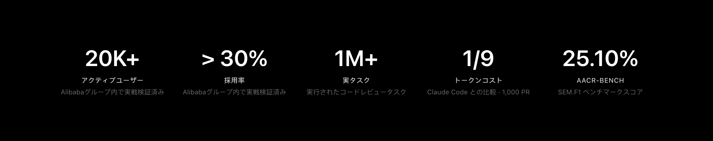
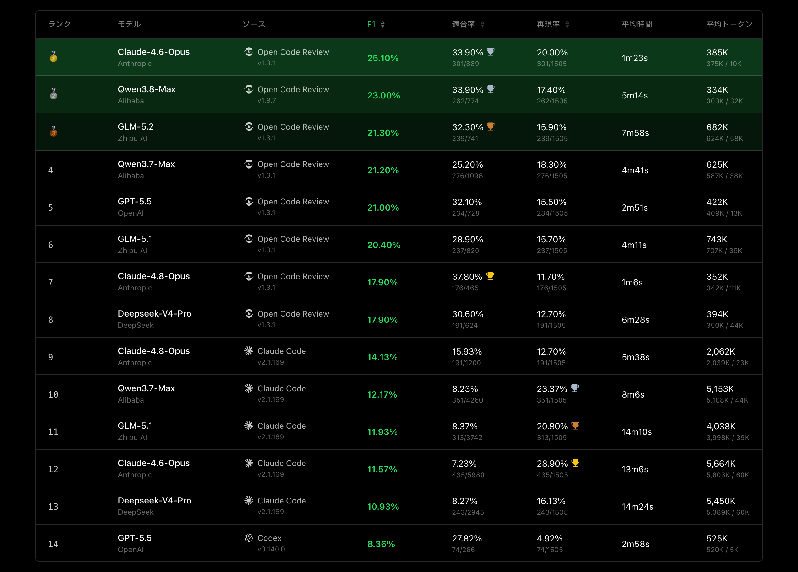

<div align="center">
  <a href="https://open-codereview.ai">
    
  </a>
  <h1>OpenCodeReview</h1>
</div>

<p align="center">
  <a href="https://trendshift.io/repositories/41087?utm_source=repository-badge&amp;utm_medium=badge&amp;utm_campaign=badge-repository-41087" target="_blank" rel="noopener noreferrer">
    
  </a>
  <a href="https://trendshift.io/repositories/41087" target="_blank">
    
  </a>
</p>
<p align="center">
  <a href="https://www.npmjs.com/package/@alibaba-group/open-code-review"></a>
  <a href="https://github.com/alibaba/open-code-review/actions/workflows/release.yml"></a>
  <a href="https://github.com/alibaba/open-code-review/blob/main/LICENSE"></a>
  <a href="https://deepwiki.com/alibaba/open-code-review"></a>
  <a href="https://www.bestpractices.dev/projects/13328"></a>
</p>
<p align="center">
  <a href="#supported-platforms"></a>
  <a href="#supported-platforms"></a>
  <a href="#supported-platforms"></a>
  <a href="#supported-agents"></a>
  <a href="#supported-agents"></a>
  <a href="#supported-agents"></a>
</p>
<p align="center">
  <a href="README.md">English</a> | <a href="README.zh-CN.md">简体中文</a> | 日本語 | <a href="README.ko-KR.md">한국어</a> | <a href="README.ru-RU.md">Русский</a>
</p>

---

## 什么是 Open Code Review？

Open Code Review 是一款基于 AI 的代码审查 CLI 工具。它最初诞生于阿里巴巴集团内部的官方 AI 代码审查助手，在过去两年中为数万名开发者提供服务，发现了数百万个代码缺陷。在大规模环境中经过充分验证后，它作为面向社区的开源项目发布。只需配置模型端点即可开始使用。

它读取 Git diff，将变更的文件通过具备工具调用能力的代理发送到可配置的 LLM，并生成具有行级精度的结构化审查意见。代理可以读取整个文件内容、搜索代码库、引用其他变更文件以获取上下文，从而生成深度审查——而不仅仅是对 diff 的表面反馈。除了 diff 审查之外，`ocr scan` 还可以审查整个文件。这对于审计不熟悉的代码库或检查没有有意义的 diff 的目录非常有用。

更多详情请访问[官方网站](https://open-codereview.ai)。



## 基准测试

> 与通用代理（Claude Code）相比，Open Code Review 在相同基础模型下实现了显著更高的**精确率（Precision）**和**F1 分数**，Token 消耗量仅为**约 1/9**，审查速度也更快。不过，其召回率（Recall）低于通用代理——这是为了降低噪声、优先保证精确率而做出的设计权衡。

基于真实代码审查的基准测试。从 **50** 个热门开源仓库中精选 **200** 个真实 Pull Request，覆盖 **10** 种编程语言——由 80 多位资深工程师进行交叉验证（**1,505** 条已标注缺陷）。

<a href="https://huggingface.co/datasets/Alibaba-Aone/aacr-bench"> 在 Hugging Face 上查看 AACR-Bench 数据集</a>。

| 指标 | 衡量内容 | 重要性 |
|------|----------|--------|
| **F1** | 精确率与召回率的调和平均值 | 衡量审查质量的最佳单一指标 |
| **精确率 (Precision)** | 报告的问题中实际缺陷的比例 | 越高 = 需要确认的误报越少 |
| **召回率 (Recall)** | 实际缺陷中被发现的比例 | 越高 = 遗漏越少 |
| **平均时间 (Avg Time)** | 每次审查的实际耗时 | 影响 CI 流水线的等待时间 |
| **平均 Token (Avg Token)** | 每次审查的总 Token 消耗量 | 直接影响 API 成本 |



## 为什么选择 Open Code Review？

### 通用代理的问题

如果你曾使用过 Claude Code Skills 等通用代理进行代码审查，你可能会遇到以下挑战：

- **覆盖不完整** — 在大型变更集中，代理往往会“偷懒”，只选择性地审查部分文件而忽略其他文件。
- **位置偏移** — 报告的问题与实际代码位置不一致，行号或文件引用经常偏离目标。
- **质量不稳定** — 自然语言驱动的 Skills 难以调试，提示词的细微差异就会导致审查质量大幅波动。

根本原因在于，纯粹由语言驱动的架构缺乏对审查过程的硬性约束。

### 核心设计：确定性工程 × 代理的混合架构

Open Code Review 的核心哲学是将确定性工程与代理相结合，让各自负责自己擅长的领域。

**确定性工程 — 硬性约束**

对于*绝对不允许出错*的审查步骤，由工程逻辑而非语言模型来保证正确性：

- **精确的文件选择** — 精确决定哪些文件应被审查、哪些应被过滤，确保重要变更不会被遗漏。
- **智能文件打包** — 将相关文件分组为单个审查单元（例如，`message_en.properties` 和 `message_zh.properties` 会被打包在一起）。每个包作为具有独立上下文的子代理运行——这是一种即使在非常大的变更集中也能保持稳定的分而治之策略，并且天然支持并行审查。
- **细粒度规则匹配** — 根据每个文件的特性匹配审查规则，使模型的注意力高度集中，从源头消除信息噪声。与纯粹由语言驱动的规则引导相比，基于模板引擎的规则匹配更加稳定和可预测。
- **外部定位与反思模块** — 独立的评论定位模块和评论反思模块，系统性地提升 AI 反馈的位置精度和内容精度。

**代理 — 动态决策**

代理的优势集中在最重要的领域——动态决策和动态上下文获取：

- **场景优化的提示词** — 针对代码审查深度优化的提示词模板，在提升效果的同时降低 Token 消耗。
- **场景优化的工具集** — 基于大规模生产数据中工具调用轨迹的深入分析——包括调用频率分布、各工具的重复率、新工具对整个调用链的影响等——提炼出的专用工具集，比通用代理工具包在代码审查中更加稳定和可预测。

## 使用方法

### 前提条件

- **Git >= 2.41** — Open Code Review 利用 Git 进行 diff 生成、代码搜索和仓库操作。

### CLI

#### 安装

```bash
npm install -g @alibaba-group/open-code-review
```

安装后，`ocr` 命令将在全局范围内可用。

其他安装方式（安装脚本、GitHub Release 二进制文件、源码构建）请参阅[安装指南](https://open-codereview.ai/docs/installation)。

#### 快速开始

**1. 配置 LLM**

代码审查前需要配置 LLM。如果使用[委托模式](https://open-codereview.ai/docs/delegate)，则无需配置。

```bash
ocr config provider          # 选择内置提供商或添加自定义提供商
ocr config model             # 选择当前提供商的模型
```


交互式界面将引导你完成提供商选择、API 密钥输入和模型配置，完成后会自动进行连接测试。

有关 CLI 设置、环境变量、自定义提供商等高级配置，请参阅[配置指南](https://open-codereview.ai/docs/configuration)。

**2. 审查**

```bash
cd your-project

# 工作区模式 — 审查所有已暂存、未暂存和未跟踪的变更
ocr review

# 分支范围 — 审查从 main 分支出来后 feature-branch 的变更（合并基础模式）
ocr review --from main --to feature-branch

# 单个提交
ocr review --commit abc123

# 恢复中断的范围或单个提交审查
ocr session list
ocr review --from main --to feature-branch --resume <session-id>

# 全文件扫描 — 审查整个文件而非 diff（无需 git 历史）
ocr scan                          # 扫描整个仓库
ocr scan --path internal/agent    # 扫描目录或特定文件
ocr scan --resume <session-id>   # 恢复中断的全文件扫描

# 委托模式 — AI 编码代理自行执行审查
# OCR 负责文件选择和规则解析。无需 LLM 配置
ocr delegate preview
ocr delegate rule src/main.go src/handler.go
```

## 文档

完整文档位于 **[open-codereview.ai/docs](https://open-codereview.ai/docs)**：

- [快速开始](https://open-codereview.ai/docs/quickstart) — 安装并执行首次审查
- [安装](https://open-codereview.ai/docs/installation) — 所有平台和包管理器
- [CLI 参考](https://open-codereview.ai/docs/cli-reference) — 所有命令和标志
- [审查规则](https://open-codereview.ai/docs/review-rules) — 自定义审查规则、路径过滤与定向
- [配置](https://open-codereview.ai/docs/configuration) — 配置键和环境变量
- [MCP 服务器](https://open-codereview.ai/docs/mcp) — 使用外部工具扩展审查代理
- 编码代理集成 — 选择你使用的平台
  - [Claude Code](plugins/open-code-review/README.md#claude-code) — 安装包含审查斜杠命令的插件
  - [Codex](plugins/open-code-review/README.md#codex) — 安装包含可调用审查技能的插件
  - [Cursor](plugins/open-code-review/README.md#cursor) — 安装包含可移植审查技能的插件
  - [OpenCode](plugins/open-code-review/opencode/README.md) — 安装原生审查工具和斜杠命令
  - [QCA Forward](plugins/open-code-review/qca/README.md) — 使用 QCA 宿主模型和可发布模板运行委托模式
  - [支持 Skill 的代理](https://open-codereview.ai/docs/agent-skill) — 安装可移植的代理技能
- 审查执行模式 — 集成后，选择由哪个 LLM 执行审查
  - [默认（由 OCR 管理）](https://open-codereview.ai/docs/configuration) — OCR 使用已配置的 LLM 执行审查
  - [委托模式](https://open-codereview.ai/docs/delegate) — 编码代理使用自身的 LLM 执行审查。无需 OCR 的 API 密钥
- [CI/CD 集成](https://open-codereview.ai/docs/cicd) — 与 GitHub Actions、GitLab CI、GitFlic CI、Gerrit 集成
- [会话查看器](https://open-codereview.ai/docs/viewer) — 在浏览器中查看和回放审查会话
- [遥测](https://open-codereview.ai/docs/telemetry) — 用于可观测性的 OpenTelemetry 集成
- [FAQ](https://open-codereview.ai/docs/faq) — 常见问题与故障排除

## 贡献

这个项目离不开所有贡献者的支持。有关开发环境搭建、编码规范和提交 Pull Request 的方法，请参阅 [CONTRIBUTING.ja-JP.md](CONTRIBUTING.ja-JP.md)。

<a href="https://github.com/alibaba/open-code-review/graphs/contributors">
  
</a>

## 许可证

[Apache-2.0](LICENSE) — Copyright 2026 Alibaba