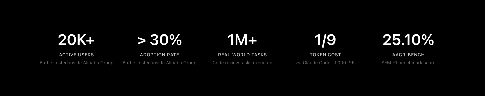
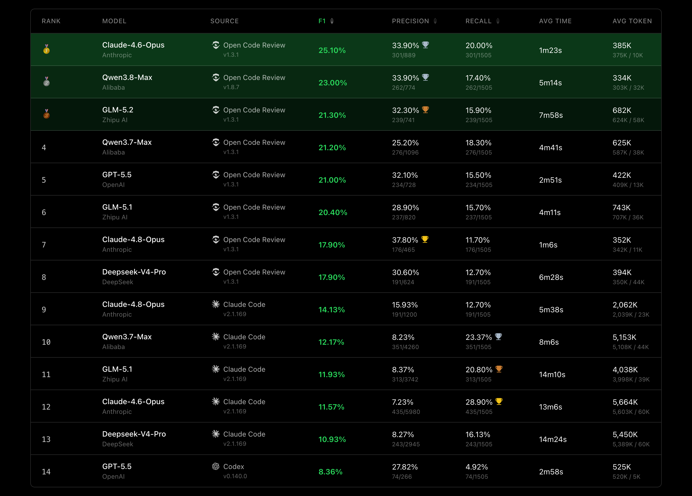

<div align="center">
  <a href="https://open-codereview.ai">
    
  </a>
  <h1>OpenCodeReview</h1>
</div>

<p align="center">
  <a href="https://trendshift.io/repositories/41087?utm_source=repository-badge&amp;utm_medium=badge&amp;utm_campaign=badge-repository-41087" target="_blank" rel="noopener noreferrer">
    
  </a>
  <a href="https://trendshift.io/repositories/41087" target="_blank">
    
  </a>
</p>
<p align="center">
  <a href="https://www.npmjs.com/package/@alibaba-group/open-code-review"></a>
  <a href="https://github.com/alibaba/open-code-review/actions/workflows/release.yml"></a>
  <a href="https://github.com/alibaba/open-code-review/blob/main/LICENSE"></a>
  <a href="https://deepwiki.com/alibaba/open-code-review"></a>
  <a href="https://www.bestpractices.dev/projects/13328"></a>
</p>
<p align="center">
  <a href="#supported-platforms"></a>
  <a href="#supported-platforms"></a>
  <a href="#supported-platforms"></a>
  <a href="#supported-agents"></a>
  <a href="#supported-agents"></a>
  <a href="#supported-agents"></a>
</p>
<p align="center">
  <a href="README.md">English</a> | <a href="README.zh-CN.md">简体中文</a> | <a href="README.ja-JP.md">日本語</a> | 한국어 | <a href="README.ru-RU.md">Русский</a>
</p>

---

## 什么是 Open Code Review？

Open Code Review 是一款基于 AI 的代码审查 CLI 工具。它源自阿里巴巴集团内部的官方 AI 代码审查助手，在过去两年中为数万名开发者提供服务，发现了数百万个代码缺陷。在大规模环境中得到充分验证后，我们将其作为开源项目贡献给社区。只需配置好模型 endpoint 即可立即使用。

该工具读取 Git diff，通过支持工具调用的 agent 将变更文件传递给可配置的 LLM，然后生成包含行级位置信息的结构化审查评论。agent 可以读取整个文件内容、搜索代码库、查看其他变更文件等来获取上下文，从而进行深入审查，而非停留在表面的 diff 反馈。除了 diff 审查外，`ocr scan` 还可以审查整个文件，这对于审计不熟悉的代码库或检查没有有意义 diff 的目录非常有用。

更多详情请参阅[官方网站](https://open-codereview.ai)。



## 基准测试

> 与通用 Agent（Claude Code）相比，Open Code Review 在相同基础模型上实现了显著更高的**精确率（Precision）**和 **F1 分数**，token 消耗量约为**1/9**，审查速度也更快。不过，召回率（Recall）低于通用 Agent——这是为了减少噪音并优先保证精确率而做出的设计权衡。

基于真实代码审查的基准测试。从**50**个热门开源仓库中精选**200**个真实 Pull Request，覆盖**10**种编程语言——由 80 多位资深工程师交叉验证（**1,505**个已标注缺陷）。

<a href="https://huggingface.co/datasets/Alibaba-Aone/aacr-bench"> 在 Hugging Face 上探索 AACR-Bench 数据集</a>。

| 指标 | 衡量内容 | 重要性 |
|------|-----------|-------------|
| **F1** | 精确率与召回率的调和平均值 | 衡量审查质量的最佳单一指标 |
| **精确率 (Precision)** | 报告的问题中实际缺陷的比例 | 越高意味着需要确认的误报越少 |
| **召回率 (Recall)** | 实际缺陷中被发现的比例 | 越高意味着遗漏的问题越少 |
| **平均时间 (Avg Time)** | 每次审查实际耗时 | 影响 CI 流水线等待时间 |
| **平均 Token (Avg Token)** | 每次审查的总 token 消耗量 | 直接影响 API 成本 |



## 为什么选择 Open Code Review？

### 通用 Agent 的问题

如果你尝试过使用 Claude Code Skills 等通用 agent 进行代码审查，可能遇到过以下问题：

- **覆盖不完整**：在大型 changeset 中，容易只选择性地审查部分文件而遗漏重要文件。
- **位置漂移**：指出的问题与实际代码位置不符，或行号与文件引用错位的情况时有发生。
- **质量不稳定**：基于自然语言的 Skill 难以调试，微小的 prompt 变化也可能导致审查质量大幅波动。

根本原因在于纯语言中心架构无法为审查流程提供强约束。

### 核心设计：确定性工程与 Agent 的混合架构

Open Code Review 的核心哲学是结合确定性工程与 agent，让各自发挥所长。

**确定性工程：强约束**

必须保证准确性的审查步骤由工程逻辑而非语言模型来保障。

- **精确的文件选择**：决定审查哪些文件、过滤哪些文件，确保重要变更不被遗漏。
- **智能文件捆绑**：将相关文件捆绑为一个审查单元。例如，将 `message_en.properties` 和 `message_zh.properties` 捆绑在一起。每个捆绑包由具有独立上下文的 sub-agent 执行，即使在大规模 changeset 中也能支持稳定的分而治之策略和并发审查。
- **细粒度规则匹配**：根据每个文件的特性匹配相应的审查规则，集中模型注意力并减少信息噪音。基于模板引擎的规则匹配比纯自然语言规则引导更稳定、更可预测。
- **外部定位与反射模块**：独立的评论定位和评论反射模块系统性地提高了 AI 反馈的位置准确性和内容准确性。

**Agent：动态决策**

agent 的优势集中在需要动态判断和动态上下文检索的关键点。

- **场景优化 prompt**：针对代码审查深度优化的 prompt 模板，提升效果并减少 token 使用量。
- **场景优化工具集**：通过分析大规模生产数据的工具调用轨迹得出。反映了调用频率分布、各工具重复率以及新工具对整个调用链的影响，提供了比通用 agent 工具包更适合代码审查、更稳定且更可预测的专用工具集。

## 使用方法

### 前提条件

- **Git >= 2.41** — Open Code Review 使用 Git 进行 diff 生成、代码搜索和仓库操作。

### CLI

#### 安装

```bash
npm install -g @alibaba-group/open-code-review
```

安装后，`ocr` 命令即可全局使用。

其他安装方式（安装脚本、GitHub Release 二进制文件、源码构建）请参阅[安装指南](https://open-codereview.ai/docs/installation)。

#### 快速开始

**1. LLM 配置**

代码审查前需要配置 LLM。如果使用[委派模式](https://open-codereview.ai/docs/delegate)，则无需配置。

```bash
ocr config provider          # 选择内置 provider 或添加自定义 provider
ocr config model             # 选择当前激活 provider 的模型
```


交互式 UI 会引导你完成 provider 选择、API key 输入和模型设置，完成后会自动进行连接测试。

有关 CLI 配置、环境变量、自定义 provider 等高级设置，请参阅[配置指南](https://open-codereview.ai/docs/configuration)。

**2. 执行审查**

```bash
cd your-project

# Workspace 模式：审查所有已暂存、未暂存和未跟踪的更改
ocr review

# 分支范围 — 审查从 main 分支分出后 feature-branch 上的更改（合并基础模式）
ocr review --from main --to feature-branch

# 单个提交
ocr review --commit abc123

# 恢复中断的范围或单个提交审查
ocr session list
ocr review --from main --to feature-branch --resume <session-id>

# 全文件扫描 — 审查整个文件而非 diff（无需 git 历史）
ocr scan                          # 扫描整个仓库
ocr scan --path internal/agent    # 扫描目录或特定文件
ocr scan --resume <session-id>   # 恢复中断的全文件扫描

# 委派模式 — AI 编码代理直接执行审查
# OCR 仅负责文件选择和规则解释；无需 LLM 配置
ocr delegate preview
ocr delegate rule src/main.go src/handler.go
```

## 文档

完整文档请参阅 **[open-codereview.ai/docs](https://open-codereview.ai/docs)**：

- [快速开始](https://open-codereview.ai/docs/quickstart) — 安装并运行首次审查
- [安装](https://open-codereview.ai/docs/installation) — 所有平台和包管理器
- [CLI 参考](https://open-codereview.ai/docs/cli-reference) — 所有命令和标志
- [审查规则](https://open-codereview.ai/docs/review-rules) — 自定义审查规则、路径过滤和定向
- [配置](https://open-codereview.ai/docs/configuration) — 配置键和环境变量
- [MCP 服务器](https://open-codereview.ai/docs/mcp) — 使用外部工具扩展审查代理
- 编码代理集成 — 选择你使用的平台
  - [Claude Code](plugins/open-code-review/README.md#claude-code) — 安装包含审查斜杠命令的插件
  - [Codex](plugins/open-code-review/README.md#codex) — 安装包含可调用审查技能的插件
  - [Cursor](plugins/open-code-review/README.md#cursor) — 安装包含可移植审查技能的插件
  - [OpenCode](plugins/open-code-review/opencode/README.md) — 安装原生审查工具和斜杠命令
  - [QCA Forward](plugins/open-code-review/qca/README.md) — 使用 QCA 宿主模型和可发布模板运行委派模式
  - [技能兼容代理](https://open-codereview.ai/docs/agent-skill) — 安装可移植的代理技能
- 审查执行模式 — 集成后选择执行审查的 LLM
  - [默认模式（OCR 管理）](https://open-codereview.ai/docs/configuration) — OCR 使用配置的 LLM 执行审查
  - [委派模式](https://open-codereview.ai/docs/delegate) — 编码代理使用自身 LLM 执行审查；无需 OCR API key
- [CI/CD 集成](https://open-codereview.ai/docs/cicd) — GitHub Actions、GitLab CI、GitFlic CI、Gerrit 集成
- [会话查看器](https://open-codereview.ai/docs/viewer) — 在浏览器中浏览和回放审查会话
- [遥测](https://open-codereview.ai/docs/telemetry) — 用于可观测性的 OpenTelemetry 集成
- [FAQ](https://open-codereview.ai/docs/faq) — 常见问题与故障排除

## 贡献

这个项目得益于所有贡献者的支持。有关开发环境设置、编码规范和提交 Pull Request 的方法，请参阅 [CONTRIBUTING.ko-KR.md](CONTRIBUTING.ko-KR.md)。

<a href="https://github.com/alibaba/open-code-review/graphs/contributors">
  
</a>

## 许可证

[Apache-2.0](LICENSE) Copyright 2026 Alibaba