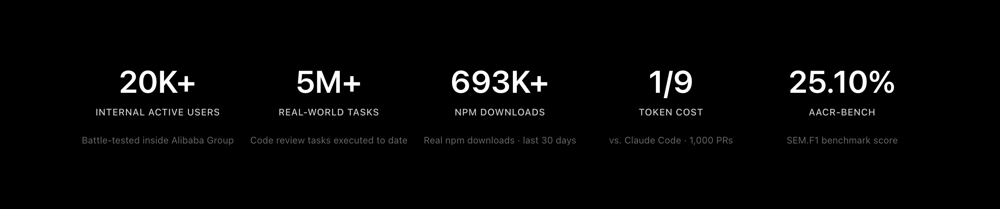
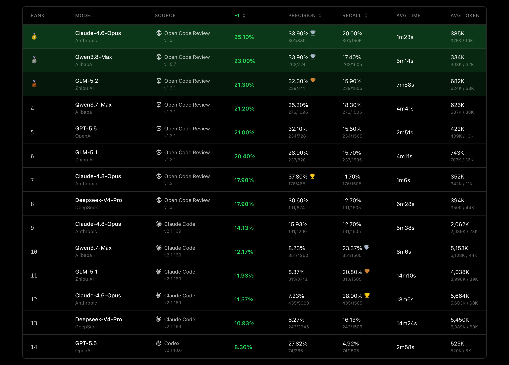
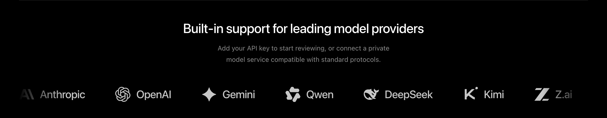

> **[中文化] open-code-review**
>
> 此项目是 [alibaba/open-code-review](https://github.com/alibaba/open-code-review) 的中文翻译版本。
> - 原项目 Stars: 55123
> - 主语言: Go
> - 许可证: Apache-2.0
> - 翻译日期: 2026-11-21
> - 原始 README: [README_en.md](README_en.md)
>
> 说明：下方 README 正文为**原项目文档的中文翻译**，力求忠于原文；本页顶部的「中文快速上手」为**面向中文用户的补充导读**（非原文内容），目的是让你不用读完整篇 README 就能先把项目跑起来。
>
> 如有翻译不准确之处，欢迎提 Issue 或 PR。

---


## 🚀 中文快速上手（补充导读，非原文）

### 这是什么 / 解决什么问题

Open Code Review 是一个 AI 驱动的代码审查 CLI 工具（命令名为 `ocr`），源自阿里巴巴内部使用了两年的 AI 代码审查助手。它读取 Git diff，把变更文件交给可配置的 LLM，由具备工具调用能力的 agent 生成带行级精度的结构化审查意见；agent 能读取完整文件内容、搜索代码库、查看其他变更文件作为上下文。除 diff 审查外，`ocr scan` 可审查整个文件，用于审计没有有意义 diff 的陌生代码库或目录。它针对的是通用 agent 做代码审查时覆盖不全、位置漂移、质量不稳定的问题，通过"确定性工程 + agent"混合架构来约束审查流程。

### 快速上手（最短路径）

1. 安装（macOS / Linux）：
   ```sh
   curl -fsSL https://open-codereview.ai/install.sh | sh
   ```
   官方也建议先下载脚本检查再执行：
   ```sh
   curl -fsSL https://open-codereview.ai/install.sh -o install.sh
   less install.sh && sh install.sh
   ```
2. Windows 使用 PowerShell 安装：
   ```powershell
   irm https://open-codereview.ai/install.ps1 | iex
   ```
3. 也可以通过 npm 安装（包名 `@alibaba-group/open-code-review`，提供 `ocr` 命令）：
   ```sh
   npm install @alibaba-group/open-code-review
   ```
4. 配置模型端点（README 原文只说"Simply configure a model endpoint to get started"，具体配置命令与参数原文未说明，请参考下方 README 正文）。
5. 在 Git 仓库中运行审查：原文未提供 `ocr` 的具体子命令与参数示例（仅提到 `ocr scan` 用于整文件审查），请参考下方 README 正文。

### 环境要求

- **操作系统**：Windows、macOS、Linux（README 徽章标注三者均支持；`install.sh` 仅支持 darwin/linux，Windows 走 `install.ps1`）。
- **CPU 架构**：`install.sh` 支持 x86_64/amd64 与 arm64/aarch64；npm 可选依赖覆盖 darwin-arm64、darwin-x64、linux-arm64、linux-x64。
- **依赖**：使用 `install.sh` 需要 `curl`；使用 npm 安装需要 Node.js（版本要求原文未说明）。
- **从源码构建**：Go 1.26.10（见 `go.mod`），构建入口为 `./cmd/opencodereview`，可用 `make build`。
- **模型端点**：需要自行配置 LLM 端点（支持 Anthropic、OpenAI 等 SDK，具体支持范围原文未完整说明）。
- 国内网络环境提示：`install.sh` 支持通过环境变量 `OCR_GITHUB_MIRROR` 指定镜像域名下载二进制，可据此加速。

### 常见坑与注意事项

- **必须自备模型端点**：工具本身不含模型，需配置 LLM 端点后才能使用；具体配置方式原文未说明。
- **安装目录权限**：`install.sh` 默认安装到 `/usr/local/bin`，普通用户可能无写权限，可用 `OCR_INSTALL_DIR` 指定其他目录。
- **平台限制**：`install.sh` 明确不支持 Windows，Windows 需改用 `install.ps1`；不支持的架构会直接报错退出。
- **审查质量取舍**：官方 benchmark 说明其 Recall 低于通用 agent，这是为降低噪声、提高精确率而做的有意取舍，不要期待它找出所有问题。

---


---

<div align="center">
  <a href="https://open-codereview.ai">
    
  </a>
  <h1>OpenCodeReview</h1>
</div>

<p align="center">
  <a href="https://trendshift.io/repositories/41087?utm_source=repository-badge&amp;utm_medium=badge&amp;utm_campaign=badge-repository-41087" target="_blank" rel="noopener noreferrer">
    
  </a>
</p>
<p align="center">
  <a href="https://trendshift.io/repositories/41087" target="_blank">
    
  </a>
  <a href="https://trendshift.io/repositories/41087" target="_blank">
    
  </a>
</p>
<p align="center">
  <a href="https://www.npmjs.com/package/@alibaba-group/open-code-review"></a>
  <a href="https://github.com/alibaba/open-code-review/actions/workflows/release.yml"></a>
  <a href="https://github.com/alibaba/open-code-review/blob/main/LICENSE"></a>
  <a href="https://deepwiki.com/alibaba/open-code-review"></a>
  <a href="https://www.bestpractices.dev/projects/13328"></a>
</p>
<p align="center">
  <a href="#supported-platforms"></a>
  <a href="#supported-platforms"></a>
  <a href="#supported-platforms"></a>
  <a href="#supported-agents"></a>
  <a href="#supported-agents"></a>
  <a href="#supported-agents"></a>
  <a href="#supported-agents"></a>
</p>
<p align="center">
  English | <a href="docs/i18n/README.zh-CN.md">简体中文</a> | <a href="docs/i18n/README.ja-JP.md">日本語</a> | <a href="docs/i18n/README.ko-KR.md">한국어</a> | <a href="docs/i18n/README.ru-RU.md">Русский</a>
</p>

---

## 什么是 Open Code Review？

Open Code Review 是一款 AI 驱动的代码审查 CLI 工具。它起源于阿里巴巴集团内部官方的 AI 代码审查助手——过去两年间，它服务了数万名开发者，发现了数百万个代码缺陷。经过大规模充分验证后，我们将其孵化开源，回馈社区。只需配置一个模型端点即可开始使用。

它读取 Git diff，通过具备工具调用能力的 agent 将变更文件发送给可配置的 LLM，生成行级精度的结构化审查评论。agent 可以读取完整文件内容、搜索代码库、查看其他变更文件以获取上下文，从而产出深度审查——而不只是表面的 diff 反馈。除 diff 审查外，`ocr scan` 可审查整个文件，适用于审计不熟悉的代码库或没有有意义 diff 的目录。

更多详情请访问[官方网站](https://open-codereview.ai)。



## 基准测试

> 与通用 agent（Claude Code）相比，Open Code Review 在相同底层模型下实现了显著更高的**精确率**和 **F1**，同时仅消耗**约 1/9 的 token**，审查速度更快。注意其召回率低于通用 agent——这是有意为之的取舍，以精确率优先于噪声。

一个基于真实场景的代码审查基准，由 **50** 个热门开源仓库、**200** 个真实 Pull Request 和 **10** 种编程语言构建——经 80+ 位资深工程师交叉验证（**1,505** 条标注的真实问题）。

<a href="https://huggingface.co/datasets/Alibaba-Aone/aacr-bench"> 在 Hugging Face 上探索 AACR-Bench 数据集</a>。

| 指标 | 衡量内容 | 重要性 |
|--------|-----------------|----------------|
| **F1** | 精确率与召回率的调和平均 | 衡量整体审查质量的最佳单一指标 |
| **精确率** | 报告问题中真实缺陷的比例 | 越高 = 需要分诊的误报越少 |
| **召回率** | 被发现的真实缺陷比例 | 越高 = 审查遗漏的问题越少 |
| **平均耗时** | 每次审查的实际耗时 | 影响 CI 流水线延迟 |
| **平均 Token** | 每次审查消耗的总 token 数 | 直接影响 API 成本 |



## 为什么选择 Open Code Review？

### 通用 agent 的问题

如果你用过 Claude Code 等通用 agent 配合 Skills 做代码审查，可能遇到过这些痛点：

- **覆盖不完整**——在较大的变更集上，agent 容易"偷工减料"，只选择性审查部分文件而遗漏其他文件。
- **位置漂移**——报告的问题经常与实际代码位置不符，行号或文件引用偏离目标。
- **质量不稳定**——自然语言驱动的 Skills 难以调试，审查质量随提示词的细微变化而显著波动。

根本原因：纯语言驱动的架构对审查过程缺乏硬性约束。

### 核心设计：确定性工程 × Agent 混合

Open Code Review 的核心理念是将确定性工程与 agent 结合，各司其职。

**确定性工程——硬性约束**

对于*绝不能出错*的审查步骤，由工程逻辑——而非语言模型——保证正确性：

- **精确的文件选择**——准确判定哪些文件需要审查、哪些应被过滤，确保不遗漏重要变更。
- **智能文件打包**——将相关文件归入同一审查单元（例如 `message_en.properties` 与 `message_zh.properties` 打包在一起）。每个包作为子 agent 运行，上下文相互隔离——这种分治策略在超大变更集上依然稳定，并天然支持并发审查。
- **细粒度规则匹配**——根据每个文件的特征匹配审查规则，让模型注意力高度聚焦，从源头消除信息噪声。相比纯语言驱动的规则引导，基于模板引擎的规则匹配更稳定、更可预测。
- **外部定位与反思模块**——独立的评论定位与评论反思模块，系统性提升 AI 反馈的位置准确性和内容准确性。

**Agent——动态决策**

agent 的优势集中在最能发挥价值的地方——动态决策与动态上下文检索：

- **场景调优的提示词**——针对代码审查深度优化的提示词模板，提升效果的同时降低 token 消耗。
- **场景调优的工具集**——基于对大规模生产数据中工具调用轨迹的深度分析（包括调用频率分布、各工具重复调用率、新工具对整体调用链的影响）提炼而成，打造出比通用 agent 工具包更稳定、更可预测的代码审查专用工具集。

## 如何使用

### 前置条件

- **Git >= 2.41**——Open Code Review 依赖 Git 进行 diff 生成、代码搜索和仓库操作。

<a id="supported-agents"></a>

### Agent Skills

在 Claude Code、Codex、Cursor、Kimi Code 或其他支持 Agent Skills 且能运行本地命令的 agent 中使用这些 skills。两种模式都需要 **Git >= 2.41** 和 **`ocr` CLI**；仅原生模式需要 OCR 模型提供方。

#### 1. 安装 Skills

在要审查的项目中运行，然后在安装器中选择所需的 skills 和你的 agent：

```bash
npx skills add alibaba/open-code-review
```

这些 skills 会引导你的 agent 在缺少 `ocr` 时安装它，受你环境的权限约束。你也可以提前用 `npm install -g @alibaba-group/open-code-review` 安装。偏好插件或手动安装？参见[各 agent 安装指南](plugins/open-code-review/README.md)，或将 [`skills/`](skills/) 中所需的文件夹复制到你的 agent skill 目录。

#### 2. 选择审查模式

| | 原生模式 | 委托模式 |
|---|---|---|
| Skill | [`open-code-review`](skills/open-code-review/SKILL.md) | [`open-code-review-delegate`](skills/open-code-review-delegate/SKILL.md) |
| 谁来审查？ | OCR 专用审查 agent 与流水线 | 你当前的编码 agent，遵循 OCR 的审查流水线与护栏 |
| 模型与认证 | OCR 自己的提供方配置 | 宿主 agent 现有的模型与认证 |
| 何时选择 | 你有 OCR 的模型端点，想要其完整审查流水线 | 你没有单独的 API key，或想使用现有的 agent 订阅/配置 |

**没有单独的 key？从委托模式开始。** 它跳过 OCR 提供方配置，但不跳过宿主 agent 自身的认证、用量限制或费用。宿主 agent 的订阅不会自动成为原生模式的 API 凭证。在委托模式下，OCR 的 CLI 和 skill 共同提供审查流水线与护栏：文件选择、规则解析、覆盖要求和结构化报告。宿主 agent 在该工作流内执行分析、定位和报告；它不会运行 OCR 的完整原生流水线。

对于原生模式，用 `ocr config provider` 和 `ocr config model` 一次性配置提供方。认证方式取决于提供方；参见[配置](https://open-codereview.ai/docs/configuration)。

### CLI

#### 安装

```bash
npm install -g @alibaba-group/open-code-review
```

安装后，`ocr` 命令全局可用。

其他安装方式（安装脚本、GitHub Release 二进制、从源码构建），参见[安装](https://open-codereview.ai/docs/installation)。

#### 快速开始

**1. 配置 LLM**

审查代码前必须配置 LLM，除非你使用[委托模式](https://open-codereview.ai/docs/delegate)。

- **OCR 调用模型：** `ocr review`、`/open-code-review:review` 命令和 `open-code-review` skill 使用 OCR 自己的提供方配置，而非你的 Claude Code Team/Pro 订阅登录。认证要求取决于提供方；参见[配置](https://open-codereview.ai/docs/configuration)。
- **宿主 agent 调用模型：** `/open-code-review:delegate-review` 命令和 `open-code-review-delegate` skill 使用宿主 agent 配置的模型与认证。OCR 中无需单独的 LLM 配置或凭证。参见 [Claude Code 安装步骤](plugins/open-code-review/README.md#claude-code)。

```bash
ocr config provider          # Select a built-in provider or add a custom one
ocr config model             # Pick a model for the active provider
```



交互式界面会引导你完成提供方选择、API key 输入和模型配置，然后自动测试连通性。

CLI 设置、环境变量、自定义提供方及其他高级配置，参见[配置](https://open-codereview.ai/docs/configuration)。

**2. 审查**

```bash
cd your-project

# Workspace mode — review all staged, unstaged, and untracked changes
ocr review

# Current branch — review changes since it diverged from main (--to defaults to HEAD)
ocr review --from main

# Branch range — reviews feature-branch's changes since it diverged from main (merge-base mode)
ocr review --from main --to feature-branch

# Single commit
ocr review --commit abc123

# Resume an interrupted range or commit review
ocr session list
ocr review --from main --to feature-branch --resume <session-id>

# Full-file scan — review whole files instead of a diff (no git history needed)
ocr scan                          # scan the entire repository
ocr scan --path internal/agent    # scan a directory or specific files
ocr scan --resume <session-id>   # resume an interrupted full-file scan

# Save results to a file (recommended for AI host agents)
ocr review --format json --output result.json

# Delegation mode — let your AI coding agent perform the review itself
# OCR handles file selection and rule resolution; no LLM configuration needed
ocr delegate preview
ocr delegate rule src/main.go src/handler.go
```

## 文档

完整文档位于 **[open-codereview.ai/docs](https://open-codereview.ai/docs)**：

- [快速开始](https://open-codereview.ai/docs/quickstart)——安装并运行你的第一次审查
- [安装](https://open-codereview.ai/docs/installation)——所有平台和包管理器
- [CLI 参考](https://open-codereview.ai/docs/cli-reference)——所有命令和参数
- [审查规则](https://open-codereview.ai/docs/review-rules)——通过路径过滤和定向自定义审查规则
- [配置](https://open-codereview.ai/docs/configuration)——配置项和环境变量
- [MCP Server](https://open-codereview.ai/docs/mcp)——用外部工具扩展审查 agent
- 编码 Agent 集成——选择你使用的平台
  - [Claude Code](plugins/open-code-review/README.md#claude-code)——安装带审查斜杠命令的插件
  - [Codex](plugins/open-code-review/README.md#codex)——安装带可调用审查 skills 的插件
  - [Cursor](plugins/open-code-review/README.md#cursor)——安装带可移植审查 skills 的插件
  - [Kimi Code](plugins/open-code-review/README.md#kimi-code)——安装带审查斜杠命令和 skills 的插件
  - [OpenCode](plugins/open-code-review/opencode/README.md)——安装原生审查工具和斜杠命令
  - [QCA Forward](plugins/open-code-review/qca/README.md)——使用 QCA 宿主模型和即用模板运行委托模式
  - [兼容 Skill 的 agent](https://open-codereview.ai/docs/agent-skill)——安装可移植的 agent skill
- 审查执行模式——集成后，选择由哪个 LLM 执行审查
  - [默认（OCR 托管）](https://open-codereview.ai/docs/configuration)——OCR 使用其配置的 LLM 运行审查
  - [委托模式](https://open-codereview.ai/docs/delegate)——你的编码 agent 使用自己的 LLM 运行审查；无需 OCR API key
- [CI/CD 集成](https://open-codereview.ai/docs/cicd)——GitHub Actions、GitLab CI、GitFlic CI 和 Gerrit 集成
- [会话查看器](https://open-codereview.ai/docs/viewer)——在浏览器中浏览和回放审查会话，将评论标记为已修复或已忽略，并在处理发现时隐藏它们
- [遥测](https://open-codereview.ai/docs/telemetry)——OpenTelemetry 集成以实现可观测性
- [FAQ](https://open-codereview.ai/docs/faq)——常见问题与故障排查

## 贡献

本项目的存在归功于所有贡献者。参见 [CONTRIBUTING.md](CONTRIBUTING.md) 了解开发环境搭建、编码规范和如何提交 Pull Request。

<a href="https://github.com/alibaba/open-code-review/graphs/contributors">
  
</a>

## 许可证

[Apache-2.0](LICENSE) — Copyright 2026 Alibaba