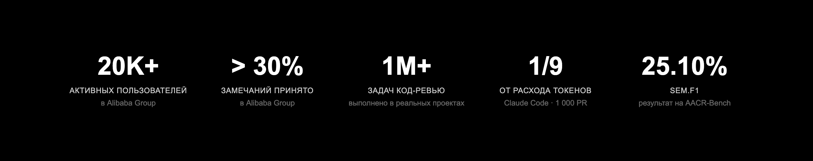
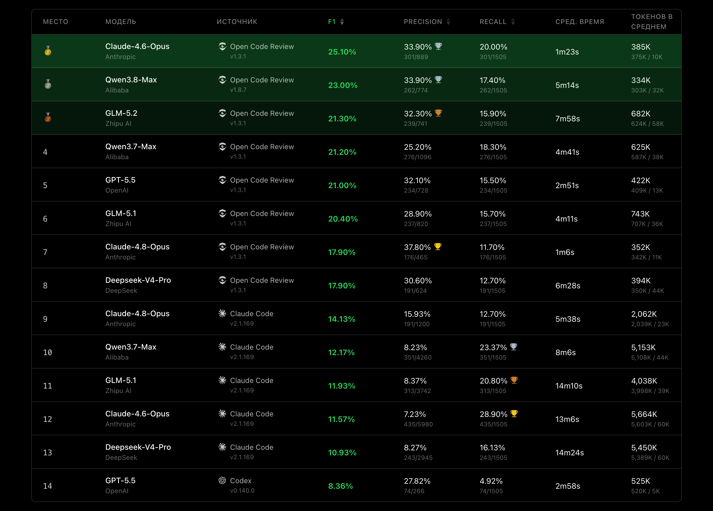
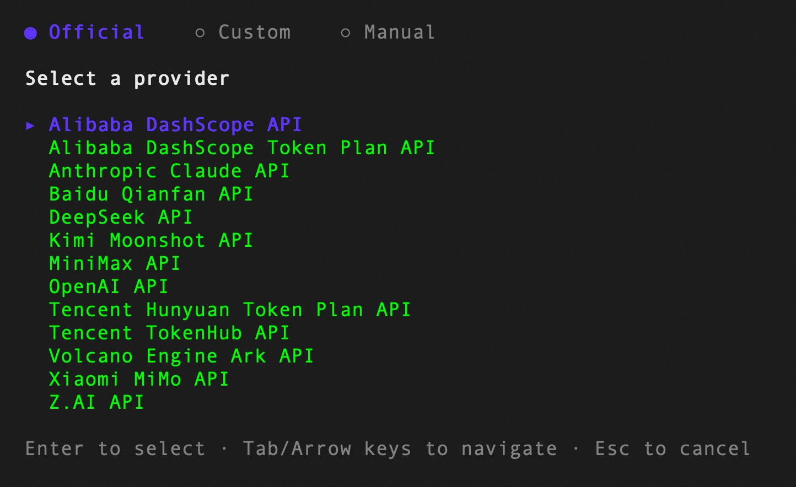

<div align="center">
  <a href="https://open-codereview.ai">
    
  </a>
  <h1>OpenCodeReview</h1>
</div>

<p align="center">
  <a href="https://trendshift.io/repositories/41087?utm_source=repository-badge&amp;utm_medium=badge&amp;utm_campaign=badge-repository-41087" target="_blank" rel="noopener noreferrer">
    
  </a>
  <a href="https://trendshift.io/repositories/41087" target="_blank">
    
  </a>
</p>
<p align="center">
  <a href="https://www.npmjs.com/package/@alibaba-group/open-code-review"></a>
  <a href="https://github.com/alibaba/open-code-review/actions/workflows/release.yml"></a>
  <a href="https://github.com/alibaba/open-code-review/blob/main/LICENSE"></a>
  <a href="https://deepwiki.com/alibaba/open-code-review"></a>
  <a href="https://www.bestpractices.dev/projects/13328"></a>
</p>
<p align="center">
  <a href="#supported-platforms"></a>
  <a href="#supported-platforms"></a>
  <a href="#supported-platforms"></a>
  <a href="#supported-agents"></a>
  <a href="#supported-agents"></a>
  <a href="#supported-agents"></a>
</p>
<p align="center">
  <a href="README.md">English</a> | <a href="README.zh-CN.md">简体中文</a> | <a href="README.ja-JP.md">日本語</a> | <a href="README.ko-KR.md">한국어</a> | Русский
</p>

---

## 什么是 Open Code Review？

Open Code Review 是一款基于 AI 的代码审查 CLI 工具。它最初是阿里巴巴集团内部官方的 AI 代码审查助手：在过去两年中，已有数万名开发者使用，并发现了数百万个代码缺陷。经过大规模严格验证后，我们将其开源给社区。开始使用只需配置一个模型端点。

该工具读取 git 差异，通过支持工具调用的代理将变更文件发送给可配置的 LLM，并生成精确到行的结构化审查评论。代理可以读取文件的完整内容、在代码库中搜索、查看其他变更文件以获取上下文，并执行深度审查——而不仅仅是针对差异给出表面意见。除了差异审查，`ocr scan` 允许审查整个文件——非常适合审计不熟悉的代码库或没有有意义差异的目录。

更多详情请访问[官方网站](https://open-codereview.ai)。



## 基准测试

> 与通用代理（如 Claude Code）相比，Open Code Review 在相同基础模型下实现了显著更高的 **精确率** 和 **F1** 分数，同时仅消耗 **约 1/9 的令牌** 并更快地完成审查。不过，其召回率低于通用代理——这是为了追求精确度和最小噪音而做出的有意权衡。

该基准测试基于真实代码审查构建，包含 **50** 个流行的开源仓库、**200** 个真实的 Pull Request 和 **10** 种编程语言。**1,505** 个缺陷的标注由 80 多位资深工程师交叉验证。

<a href="https://huggingface.co/datasets/Alibaba-Aone/aacr-bench"> 在 Hugging Face 上打开 AACR-Bench 数据集</a>。

| 指标 | 衡量内容 | 为何重要 |
|---------|-------------|--------------|
| **F1** | 精确率和召回率的调和平均值 | 审查质量的最佳单一指标 |
| **精确率** | 发现的问题中属于真实缺陷的比例 | 越高 = 误报越少 |
| **召回率** | 真实缺陷中被发现的比例 | 越高 = 遗漏问题越少 |
| **平均耗时** | 单次审查的执行时间 | 影响 CI 流水线中的延迟 |
| **平均令牌数** | 单次审查的总令牌消耗 | 直接影响 API 成本 |



## 为什么选择 Open Code Review？

### 通用代理的问题

如果您曾使用通用代理（例如带 Skills 的 Claude Code）进行代码审查，您很可能遇到过以下问题：

- **覆盖不全** — 在大型变更集上，代理倾向于“走捷径”：有选择地检查部分文件并跳过其余文件。
- **位置漂移** — 发现的问题通常与实际代码位置不符：行号和文件引用偏离目标。
- **质量不稳定** — 由自然语言驱动的 Skills 难以调试，提示词的微小变化会导致审查质量显著波动。

根本原因：纯语言架构未对审查过程施加硬性约束。

### 核心理念：确定性工程 × 代理

Open Code Review 的核心哲学是结合确定性工程和代理，让各自发挥所长。

**确定性工程 — 硬性保证**

对于审查中*不能出错*的步骤，正确性由工程逻辑而非语言模型保证：

- **精确的文件选择** — 准确确定哪些文件需要审查、哪些应被过滤，确保不遗漏任何重要变更。
- **相关文件分组** — 将相关文件合并为一个审查单元（例如 `message_en.properties` 和 `message_zh.properties`）。每个组由独立的子代理在隔离的上下文中处理。“分而治之”的方法在非常大的变更中保持稳定性，并允许并行审查。
- **精确的规则匹配** — 根据每个文件的特性匹配审查规则，将模型注意力集中在任务上并消除多余的信息噪音。基于模板的匹配比仅依赖自然语言的规则管理更稳定、更可预测。
- **外部定位与反思模块** — 独立的评论定位模块和评论反思模块系统性地提高了 AI 评论的位置和内容的准确性。

**代理 — 动态决策**

代理的优势集中在最重要的地方——动态决策和动态上下文补充：

- **针对场景优化的提示词** — 深度针对代码审查优化的提示词模板：更少的令牌消耗，更高的质量。
- **专用工具集** — 基于真实项目中工具调用的分析构建：调用频率、每个工具的重用率以及新工具对整个链路的影响。这样的工具集在代码审查中比通用代理工具更稳定、更可预测。

## 如何使用

### 前提条件

- **Git >= 2.41** — Open Code Review 使用 Git 生成差异、搜索代码和执行仓库操作。

### CLI

#### 安装

```bash
npm install -g @alibaba-group/open-code-review
```

安装后，`ocr` 命令全局可用。

其他安装方式（安装脚本、GitHub Release 中的二进制文件、从源码构建）在[安装指南](https://open-codereview.ai/docs/installation)中有详细说明。

#### 快速开始

**1. 配置 LLM**

除非使用[委派模式](https://open-codereview.ai/docs/delegate)，否则在运行审查前需要配置 LLM。

```bash
ocr config provider          # 选择内置提供商或添加自定义提供商
ocr config model             # 为当前激活的提供商选择模型
```



交互式 UI 将引导您完成提供商选择、API 密钥输入和模型配置，之后会自动验证连接。

通过 CLI、环境变量、自定义提供商和其他高级选项进行配置的方法在[配置指南](https://open-codereview.ai/docs/configuration)中有详细说明。

**2. 运行审查**

```bash
cd your-project

# 工作副本模式 — 审查所有已暂存、未暂存和未跟踪的更改
ocr review

# 分支范围 — 审查 feature 分支自其从 main 分离以来的更改（merge-base 模式）
ocr review --from main --to feature-branch

# 单个提交
ocr review --commit abc123

# 恢复中断的范围或单个提交审查
ocr session list
ocr review --from main --to feature-branch --resume <session-id>

# 全文件扫描 — 审查整个文件而非差异（无需 git 历史）
ocr scan                          # 扫描整个仓库
ocr scan --path internal/agent    # 扫描目录或特定文件
ocr scan --resume <session-id>   # 恢复中断的全文件扫描

# 委派模式 — AI 代理自行执行审查
# OCR 负责文件选择和规则解析；无需配置 LLM
ocr delegate preview
ocr delegate rule src/main.go src/handler.go
```

## 文档

完整文档可在 **[open-codereview.ai/docs](https://open-codereview.ai/docs)** 获取：

- [快速开始](https://open-codereview.ai/docs/quickstart) — 安装并运行首次审查
- [安装](https://open-codereview.ai/docs/installation) — 所有平台和包管理器
- [CLI 参考](https://open-codereview.ai/docs/cli-reference) — 所有命令和标志
- [审查规则](https://open-codereview.ai/docs/review-rules) — 自定义审查规则、过滤和路径定向
- [配置](https://open-codereview.ai/docs/configuration) — 配置键和环境变量
- [MCP 服务器](https://open-codereview.ai/docs/mcp) — 使用外部工具扩展审查代理
- 编码代理集成 — 选择您使用的平台
  - [Claude Code](plugins/open-code-review/README.md#claude-code) — 安装带审查斜杠命令的插件
  - [Codex](plugins/open-code-review/README.md#codex) — 安装带可调用审查技能的插件
  - [Cursor](plugins/open-code-review/README.md#cursor) — 安装带可移植审查技能的插件
  - [OpenCode](plugins/open-code-review/opencode/README.md) — 安装原生审查工具和斜杠命令
  - [QCA Forward](plugins/open-code-review/qca/README.md) — 使用 QCA 宿主模型和可发布模板运行委派模式
  - [支持 Skill 的代理](https://open-codereview.ai/docs/agent-skill) — 安装可移植的代理技能
- 审查执行模式 — 集成后，选择由哪个 LLM 执行审查
  - [默认（由 OCR 管理）](https://open-codereview.ai/docs/configuration) — OCR 使用配置的 LLM 执行审查
  - [委派模式](https://open-codereview.ai/docs/delegate) — 编码代理使用自己的 LLM 执行审查；无需为 OCR 提供 API 密钥
- [CI/CD 集成](https://open-codereview.ai/docs/cicd) — GitHub Actions、GitLab CI、GitFlic CI 和 Gerrit
- [会话查看](https://open-codereview.ai/docs/viewer) — 在浏览器中查看和回放审查会话
- [遥测](https://open-codereview.ai/docs/telemetry) — 与 OpenTelemetry 集成以实现可观测性
- [FAQ](https://open-codereview.ai/docs/faq) — 常见问题和故障排除

## 参与开发

这个项目离不开每一位贡献者。在 [CONTRIBUTING.ru-RU.md](CONTRIBUTING.ru-RU.md) 中描述了开发环境设置、代码规范以及提交 Pull Request 的流程。

<a href="https://github.com/alibaba/open-code-review/graphs/contributors">
  
</a>

## 许可证

[Apache-2.0](LICENSE) — 版权所有 2026 Alibaba