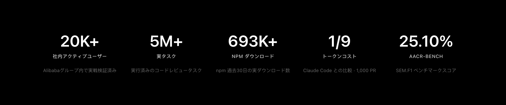
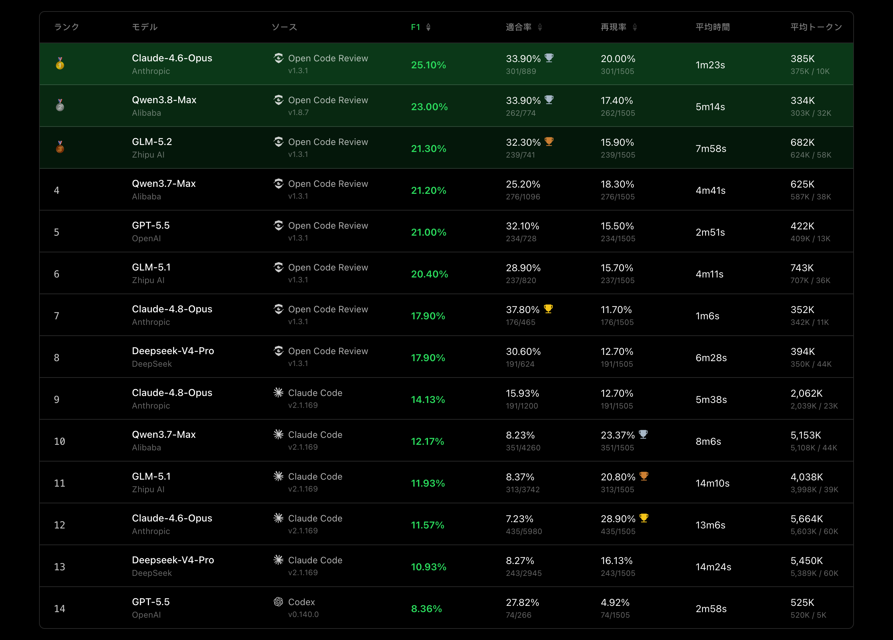
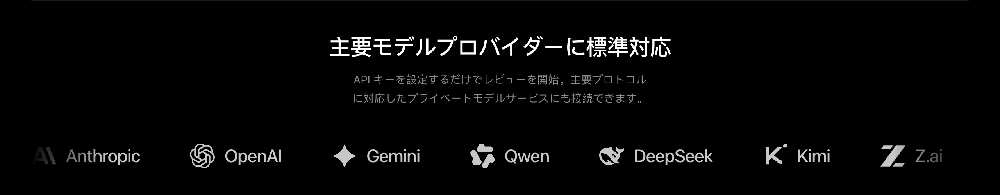

<div align="center">
  <a href="https://open-codereview.ai">
    
  </a>
  <h1>OpenCodeReview</h1>
</div>

<p align="center">
  <a href="https://trendshift.io/repositories/41087?utm_source=repository-badge&amp;utm_medium=badge&amp;utm_campaign=badge-repository-41087" target="_blank" rel="noopener noreferrer">
    
  </a>
</p>
<p align="center">
  <a href="https://trendshift.io/repositories/41087" target="_blank">
    
  </a>
  <a href="https://trendshift.io/repositories/41087" target="_blank">
    
  </a>
</p>
<p align="center">
  <a href="https://www.npmjs.com/package/@alibaba-group/open-code-review"></a>
  <a href="https://github.com/alibaba/open-code-review/actions/workflows/release.yml"></a>
  <a href="https://github.com/alibaba/open-code-review/blob/main/LICENSE"></a>
  <a href="https://deepwiki.com/alibaba/open-code-review"></a>
  <a href="https://www.bestpractices.dev/projects/13328"></a>
</p>
<p align="center">
  <a href="#supported-platforms"></a>
  <a href="#supported-platforms"></a>
  <a href="#supported-platforms"></a>
  <a href="#supported-agents"></a>
  <a href="#supported-agents"></a>
  <a href="#supported-agents"></a>
  <a href="#supported-agents"></a>
</p>
<p align="center">
  <a href="../../README.md">English</a> | <a href="README.zh-CN.md">简体中文</a> | 日本語 | <a href="README.ko-KR.md">한국어</a> | <a href="README.ru-RU.md">Русский</a>
</p>

---

## 什么是 Open Code Review？

Open Code Review 是一款 AI 驱动的代码审查 CLI 工具。它最初作为阿里巴巴集团内部的官方 AI 代码审查助手诞生，过去两年服务了数万名开发者，发现了数百万个代码缺陷。经过大规模环境的充分验证后，现已作为面向社区的开源项目发布。只需配置模型端点即可开始使用。

它读取 Git diff，将变更文件通过具备工具调用能力的 Agent 发送给可配置的 LLM，生成行级精度的结构化审查评论。Agent 可以读取完整文件内容、搜索代码库、参考其他变更文件获取上下文，从而生成深度审查——而非仅对 diff 表面给出反馈。除 diff 审查外，`ocr scan` 还可审查整个文件，适用于审计不熟悉的代码库或检查没有有意义 diff 的目录。

详情请访问[官方网站](https://open-codereview.ai)。



## 基准测试

> 与通用 Agent（Claude Code）相比，Open Code Review 在相同基座模型下实现了显著更高的**精度（Precision）**和**F1 分数**，Token 消耗仅为**约 1/9**，审查速度也更快。但召回率（Recall）低于通用 Agent——这是优先抑制噪声、保证精度的设计取舍。

基于真实代码审查的基准测试。从 **50** 个热门开源仓库中精选 **200** 个真实 Pull Request，覆盖 **10** 种编程语言——由 80 余位资深工程师交叉验证（**1,505** 条已标注缺陷）。

<a href="https://huggingface.co/datasets/Alibaba-Aone/aacr-bench"> 在 Hugging Face 查看 AACR-Bench 数据集</a>。

| 指标 | 衡量内容 | 重要性 |
|------|----------|--------|
| **F1** | 精度与召回率的调和平均 | 衡量审查质量的最佳单一指标 |
| **精度 (Precision)** | 报告问题中真实缺陷的占比 | 高 = 需确认的误报更少 |
| **召回率 (Recall)** | 真实缺陷中被发现的占比 | 高 = 遗漏更少 |
| **平均时间 (Avg Time)** | 每次审查的实际耗时 | 影响 CI 流水线的等待时间 |
| **平均 Token (Avg Token)** | 每次审查的总 Token 消耗 | 直接影响 API 成本 |



## 为什么选择 Open Code Review？

### 通用 Agent 的问题

如果你曾用 Claude Code 的 Skills 等通用 Agent 做代码审查，可能遇到过以下问题：

- **覆盖不完整** — 变更集较大时，Agent 容易"偷懒"，只选择性审查部分文件而遗漏其他文件。
- **位置偏移** — 报告的问题与实际代码位置不一致，行号和文件引用经常偏离目标。
- **质量不稳定** — 自然语言驱动的 Skills 难以调试，提示词的细微差异就会导致审查质量大幅波动。

根本原因在于，纯语言驱动的架构缺乏对审查流程的硬性约束。

### 核心设计：确定性工程 × Agent 混合

Open Code Review 的核心理念是将确定性工程与 Agent 结合，让各自负责擅长的领域。

**确定性工程 — 硬性约束**

对于*绝对不能出错*的审查步骤，由工程逻辑而非语言模型保证正确性：

- **精确的文件选择** — 准确决定审查哪些文件、过滤哪些文件，确保重要变更不被遗漏。
- **智能文件打包** — 将相关文件归入同一审查单元（例如 `message_en.properties` 与 `message_zh.properties` 会打包在一起）。每个包作为拥有独立上下文的子 Agent 运行——这种分治策略在超大变更集下依然稳定，并天然支持并行审查。
- **细粒度规则匹配** — 根据每个文件的特性匹配审查规则，让模型注意力高度集中，从源头消除信息噪声。相比纯语言驱动的规则引导，基于模板引擎的规则匹配更稳定、更可预测。
- **外部定位与反思模块** — 独立的评论定位模块和评论反思模块，系统性地提升 AI 反馈的位置精度和内容精度。

**Agent — 动态决策**

Agent 的优势集中在最关键的领域——动态决策与动态上下文获取：

- **场景优化提示词** — 针对代码审查深度优化的提示词模板，在提升效果的同时降低 Token 消耗。
- **场景优化工具集** — 基于大规模生产数据中工具调用链路的深入分析——调用频率分布、各工具重复率、新工具对整体调用链的影响等——提炼出的专用工具集，在代码审查中比通用 Agent 工具包更稳定、更可预测。

## 使用方法

### 前提条件

- **Git >= 2.41** — Open Code Review 使用 Git 进行 diff 生成、代码搜索和仓库操作。

<a id="supported-agents"></a>

### Agent Skills

可在 Claude Code、Codex、Cursor、Kimi Code 等支持 Agent Skills 且能执行本地命令的 Agent 中使用。两种模式都需要 **Git >= 2.41** 和 **`ocr` CLI**，但只有原生模式需要配置 OCR 的模型提供商。

#### 1. 安装 Skill

在待审查的项目中执行，通过安装器选择所需的 Skill 和 Agent。

```bash
npx skills add alibaba/open-code-review
```

如果没有 `ocr`，Skill 会根据环境权限引导 Agent 进行安装。也可以提前执行 `npm install -g @alibaba-group/open-code-review`。关于插件或手动安装，请参阅[按 Agent 分类的指南](../../plugins/open-code-review/README.md)，或将 [`skills/`](../../skills/) 中所需的文件夹复制到 Agent 的 Skill 目录。

#### 2. 选择审查模式

| | 原生模式 | 委托模式 |
|---|---|---|
| Skill | [`open-code-review`](../../skills/open-code-review/SKILL.md) | [`open-code-review-delegate`](../../skills/open-code-review-delegate/SKILL.md) |
| 审查执行方 | OCR 专用审查 Agent 与流水线 | 遵循 OCR 审查流水线与护栏的当前 Agent |
| 模型与认证 | OCR 独立的提供商配置 | 宿主 Agent 现有的模型与认证 |
| 适用场景 | 有 OCR 的模型端点，希望使用完整审查流水线 | 没有额外的 API Key，或希望使用现有 Agent 的合约与配置 |

**如果没有额外的 Key，请从委托模式开始。** 委托模式仅免除 OCR 的提供商配置，宿主 Agent 的认证、用量限制和费用仍然适用。Agent 的订阅不能作为原生模式的 API 凭据。在委托模式下，OCR 的 CLI 与 Skill 共同提供审查流水线与护栏，包括文件选择、规则解析、覆盖要求和结构化报告。宿主 Agent 按此流程进行分析、定位和报告，而非执行 OCR 的完整原生流水线。

原生模式需通过 `ocr config provider` 和 `ocr config model` 一次性配置。认证要求因提供商而异，请参阅[配置](https://open-codereview.ai/docs/configuration)。

### CLI

#### 安装

```bash
npm install -g @alibaba-group/open-code-review
```

安装后，`ocr` 命令即可全局使用。

其他安装方式（安装脚本、GitHub Release 二进制、源码构建）请参阅[安装指南](https://open-codereview.ai/docs/installation)。

#### 快速开始

**1. 配置 LLM**

代码审查前需配置 LLM。使用[委托模式](https://open-codereview.ai/docs/delegate)时无需配置。

- **OCR 调用模型时：** `ocr review`、`/open-code-review:review` 命令和 `open-code-review` Skill 使用 OCR 侧的提供商配置，而非 Claude Code Team/Pro 订阅登录。认证要求因提供商而异，请参阅[配置](https://open-codereview.ai/docs/configuration)。
- **宿主 Agent 调用模型时：** `/open-code-review:delegate-review` 命令和 `open-code-review-delegate` Skill 使用宿主 Agent 配置的模型与认证方式，无需在 OCR 侧另行配置 LLM 或凭据。请参阅 [Claude Code 安装步骤](../../plugins/open-code-review/README.md#claude-code)。

```bash
ocr config provider          # 选择内置提供商或添加自定义提供商
ocr config model             # 为当前提供商选择模型
```



交互式 UI 会引导你选择提供商、输入 API Key 并配置模型，完成后自动进行连接测试。

关于 CLI 设置、环境变量、自定义提供商等高级配置，请参阅[配置指南](https://open-codereview.ai/docs/configuration)。

**2. 审查**

```bash
cd your-project

# 工作区模式 — 审查所有已暂存、未暂存和未跟踪的变更
ocr review

# 当前分支 — 审查从 main 分叉后的变更（--to 默认为 HEAD）
ocr review --from main

# 分支范围 — 审查 feature-branch 从 main 分叉后的变更（合并基模式）
ocr review --from main --to feature-branch

# 单个提交
ocr review --commit abc123

# 恢复中断的范围或单 commit 审查
ocr session list
ocr review --from main --to feature-branch --resume <session-id>

# 全文件扫描 — 审查整个文件而非 diff（无需 git 历史）
ocr scan                          # 扫描整个仓库
ocr scan --path internal/agent    # 扫描目录或特定文件
ocr scan --resume <session-id>   # 恢复中断的全文件扫描

# 将结果输出到文件（推荐 AI 宿主 Agent 使用）
ocr review --format json --output result.json

# 委托模式 — 由 AI 编码 Agent 自行执行审查
# OCR 负责文件选择与规则解析，无需 LLM 配置
ocr delegate preview
ocr delegate rule src/main.go src/handler.go
```

## 文档

完整文档请访问 **[open-codereview.ai/docs](https://open-codereview.ai/docs)**：

- [快速开始](https://open-codereview.ai/docs/quickstart) — 安装并执行首次审查
- [安装](https://open-codereview.ai/docs/installation) — 所有平台与包管理器
- [CLI 参考](https://open-codereview.ai/docs/cli-reference) — 所有命令与参数
- [审查规则](https://open-codereview.ai/docs/review-rules) — 自定义审查规则、路径过滤与定向
- [配置](https://open-codereview.ai/docs/configuration) — 配置项与环境变量
- [MCP 服务器](https://open-codereview.ai/docs/mcp) — 用外部工具扩展审查 Agent
- 编码 Agent 集成 — 选择所用平台
  - [Claude Code](../../plugins/open-code-review/README.md#claude-code) — 安装含审查斜杠命令的插件
  - [Codex](../../plugins/open-code-review/README.md#codex) — 安装含可调用审查 Skill 的插件
  - [Cursor](../../plugins/open-code-review/README.md#cursor) — 安装含可移植审查 Skill 的插件
  - [Kimi Code](../../plugins/open-code-review/README.md#kimi-code) — 安装含审查斜杠命令与 Skill 的插件
  - [OpenCode](../../plugins/open-code-review/opencode/README.md) — 安装原生审查工具与斜杠命令
  - [QCA Forward](../../plugins/open-code-review/qca/README.md) — 使用 QCA 宿主模型和可发布模板运行委托模式
  - [支持 Skill 的 Agent](https://open-codereview.ai/docs/agent-skill) — 安装可移植的 Agent Skill
- 审查执行模式 — 集成后选择由哪个 LLM 执行审查
  - [默认（OCR 管理）](https://open-codereview.ai/docs/configuration) — OCR 使用已配置的 LLM 执行审查
  - [委托模式](https://open-codereview.ai/docs/delegate) — 编码 Agent 使用自身 LLM 执行审查，无需 OCR 的 API Key
- [CI/CD 集成](https://open-codereview.ai/docs/cicd) — 与 GitHub Actions、GitLab CI、GitFlic CI、Gerrit 集成
- [会话查看器](https://open-codereview.ai/docs/viewer) — 在浏览器中查看和回放审查会话，可将评论标记为已修复/已忽略以隐藏
- [遥测](https://open-codereview.ai/docs/telemetry) — 用于可观测性的 OpenTelemetry 集成
- [FAQ](https://open-codereview.ai/docs/faq) — 常见问题与故障排查

## 贡献

本项目的成功离不开所有贡献者的支持。关于开发环境搭建、编码规范和 Pull Request 提交方式，请参阅 [CONTRIBUTING.ja-JP.md](CONTRIBUTING.ja-JP.md)。

<a href="https://github.com/alibaba/open-code-review/graphs/contributors">
  
</a>

## 许可证

[Apache-2.0](../../LICENSE) — Copyright 2026 Alibaba