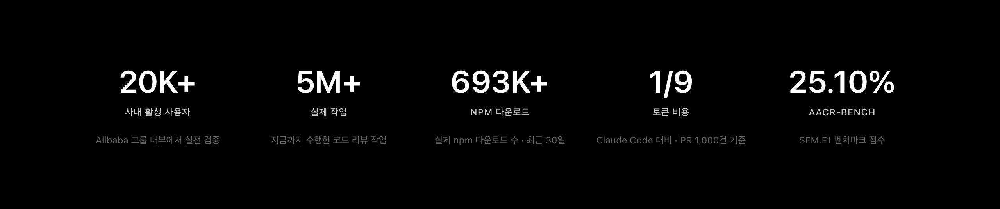
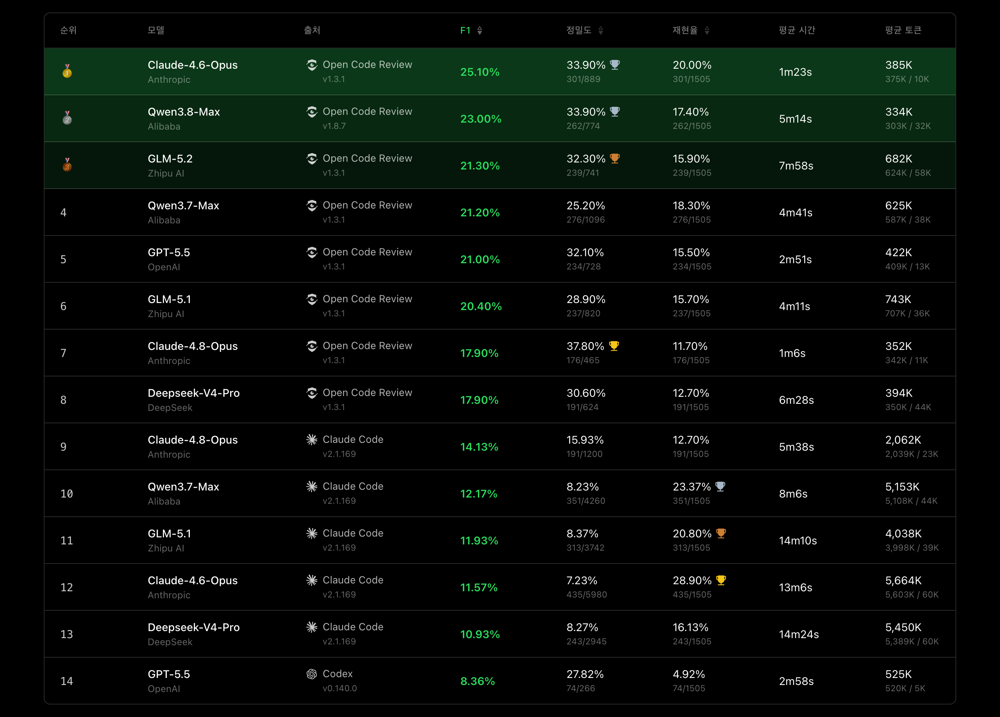
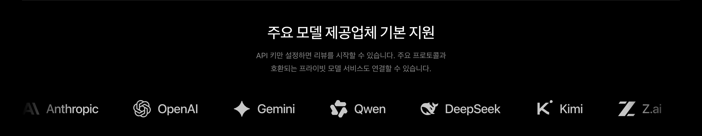

<div align="center">
  <a href="https://open-codereview.ai">
    
  </a>
  <h1>OpenCodeReview</h1>
</div>

<p align="center">
  <a href="https://trendshift.io/repositories/41087?utm_source=repository-badge&amp;utm_medium=badge&amp;utm_campaign=badge-repository-41087" target="_blank" rel="noopener noreferrer">
    
  </a>
</p>
<p align="center">
  <a href="https://trendshift.io/repositories/41087" target="_blank">
    
  </a>
  <a href="https://trendshift.io/repositories/41087" target="_blank">
    
  </a>
</p>
<p align="center">
  <a href="https://www.npmjs.com/package/@alibaba-group/open-code-review"></a>
  <a href="https://github.com/alibaba/open-code-review/actions/workflows/release.yml"></a>
  <a href="https://github.com/alibaba/open-code-review/blob/main/LICENSE"></a>
  <a href="https://deepwiki.com/alibaba/open-code-review"></a>
  <a href="https://www.bestpractices.dev/projects/13328"></a>
</p>
<p align="center">
  <a href="#supported-platforms"></a>
  <a href="#supported-platforms"></a>
  <a href="#supported-platforms"></a>
  <a href="#supported-agents"></a>
  <a href="#supported-agents"></a>
  <a href="#supported-agents"></a>
  <a href="#supported-agents"></a>
</p>
<p align="center">
  <a href="../../README.md">English</a> | <a href="README.zh-CN.md">简体中文</a> | <a href="README.ja-JP.md">日本語</a> | 한국어 | <a href="README.ru-RU.md">Русский</a>
</p>

---

## 什么是 Open Code Review？

Open Code Review 是一款 AI 驱动的代码审查 CLI 工具。它起源于 Alibaba Group 内部的官方 AI 代码审查助手，过去两年服务了数万名开发者，发现了数百万个代码缺陷。经过大规模环境充分验证后，我们将其作为开源项目发布给社区。只需配置模型 endpoint 即可使用。

该工具读取 Git diff，将变更文件通过具备 tool-use 能力的 agent 传给可配置的 LLM，然后生成带行级位置信息的结构化审查评论。agent 可以读取完整文件内容、搜索代码库、查看其他变更文件来获取上下文，从而进行深度审查，而非停留在表面的 diff 反馈。除 diff 审查外，`ocr scan` 还可以审查整个文件，适合审计不熟悉的代码库或审查没有有意义 diff 的目录。

更多信息请参阅[官方网站](https://open-codereview.ai)。



## 基准测试

> 与通用 Agent（Claude Code）相比，Open Code Review 在相同基础模型下实现了显著更高的**精确率（Precision）**和 **F1 分数**，token 消耗约为 **1/9**，审查速度也更快。但召回率（Recall）低于通用 Agent——这是减少噪声、优先保证精确率的设计取舍。

基于真实代码审查的基准测试。从 **50** 个热门开源仓库中精选 **200** 个真实 Pull Request，覆盖 **10** 种编程语言——80 余名资深工程师交叉验证（**1,505** 个标注缺陷）。

<a href="https://huggingface.co/datasets/Alibaba-Aone/aacr-bench"> 在 Hugging Face 上查看 AACR-Bench 数据集</a>。

| 指标 | 衡量内容 | 重要性 |
|------|-----------|-------------|
| **F1** | 精确率与召回率的调和平均 | 衡量审查质量的最佳单一指标 |
| **精确率（Precision）** | 报告的问题中真实缺陷的比例 | 越高，需要核实的误报越少 |
| **召回率（Recall）** | 真实缺陷中被发现的比例 | 越高，遗漏的问题越少 |
| **平均时间（Avg Time）** | 每次审查的实际耗时 | 影响 CI 流水线等待时间 |
| **平均 Token（Avg Token）** | 每次审查的总 token 消耗 | 直接影响 API 成本 |



## 为什么选择 Open Code Review？

### 通用 Agent 的问题

如果你用 Claude Code Skills 等通用 agent 做过代码审查，可能遇到过以下问题：

- **覆盖不完整**：在大型 changeset 中容易只选择性审查部分文件，遗漏重要文件。
- **位置漂移**：指出的问题与实际代码位置不符，或行号和文件引用错位。
- **质量不稳定**：基于自然语言的 Skill 难以调试，prompt 的微小变化也可能导致审查质量大幅波动。

根本原因在于纯语言中心架构无法为审查流程提供强约束。

### 核心设计：确定性工程与 Agent 的混合

Open Code Review 的核心理念是结合确定性工程与 agent，让各自承担最擅长的工作。

**确定性工程：强约束**

必须精确的审查步骤由工程逻辑而非语言模型保证。

- **精确的文件选择**：决定审查哪些文件、过滤哪些文件，确保重要变更不被遗漏。
- **智能文件打包**：将相关文件打包为一个审查单元。例如将 `message_en.properties` 和 `message_zh.properties` 打包在一起。每个包作为拥有独立 context 的 sub-agent 运行，在大型 changeset 中也能支持稳定的分治策略和并发审查。
- **细粒度 rule 匹配**：根据每个文件的特性匹配审查 rule，集中模型注意力，减少信息噪声。基于 template engine 的 rule 匹配比纯自然语言的 rule 引导更稳定、更可预测。
- **外部定位与 reflection 模块**：独立的 comment positioning 和 comment reflection 模块系统性地提升 AI 反馈的位置准确度和内容准确度。

**Agent：动态决策**

agent 的优势集中在动态判断和动态 context 检索至关重要的环节。

- **场景优化 prompt**：深度针对代码审查优化的 prompt template，提升效果并减少 token 用量。
- **场景优化 toolset**：通过分析大规模生产数据的 tool-call trace 得出。基于调用频率分布、各 tool 的重复率、新 tool 对整体 call chain 的影响等，提供比通用 agent toolkit 更稳定、更可预测的代码审查专用 toolset。

## 使用方法

### 前置要求

- **Git >= 2.41** — Open Code Review 使用 Git 生成 diff、搜索代码和执行仓库操作。

<a id="supported-agents"></a>

### Agent Skills

可在支持 Agent Skills 且能执行本地命令的 agent 中使用，如 Claude Code、Codex、Cursor、Kimi Code 等。两种模式都需要 **Git >= 2.41** 和 **`ocr` CLI**，OCR 模型供应商配置仅原生模式需要。

#### 1. 安装技能

在要审查的项目中执行以下命令，然后在安装程序中选择所需的技能和 agent。

```bash
npx skills add alibaba/open-code-review
```

如果没有 `ocr`，技能会根据环境权限引导 agent 进行安装。也可以预先通过 `npm install -g @alibaba-group/open-code-review` 安装。插件或手动安装请参阅[各 agent 配置指南](../../plugins/open-code-review/README.md)，或从 [`skills/`](../../skills/) 复制所需文件夹到 agent 的技能目录。

#### 2. 选择审查模式

| | 原生模式 | 委托模式 |
|---|---|---|
| 技能 | [`open-code-review`](../../skills/open-code-review/SKILL.md) | [`open-code-review-delegate`](../../skills/open-code-review-delegate/SKILL.md) |
| 审查执行方 | OCR 专用审查 agent 与流水线 | 遵循 OCR 审查流水线与护栏的当前编码 agent |
| 模型与认证 | OCR 自身的供应商配置 | 宿主 agent 现有的模型与认证 |
| 推荐场景 | 有 OCR 模型 endpoint 并希望使用完整审查流水线 | 没有独立 API key，或希望复用现有 agent 订阅与配置 |

**如果没有独立 key，请从委托模式开始。** 仅省略 OCR 供应商配置，宿主 agent 的认证、用量限制和费用照常适用。agent 订阅不会成为原生模式的 API 凭证。委托模式下，OCR 的 CLI 和技能共同提供审查流水线与护栏，包括文件选择、规则解析、覆盖率要求和结构化报告。宿主 agent 按此流程执行分析、定位和报告，但不运行 OCR 的完整原生流水线。

原生模式通过 `ocr config provider` 和 `ocr config model` 一次性配置。认证要求因供应商而异，请参阅[配置指南](https://open-codereview.ai/docs/configuration)。

### CLI

#### 安装

```bash
npm install -g @alibaba-group/open-code-review
```

安装后即可全局使用 `ocr` 命令。

其他安装方式（安装脚本、GitHub Release binary、源码构建）请参阅[安装指南](https://open-codereview.ai/docs/installation)。

#### 快速开始

**1. 配置 LLM**

代码审查前需要配置 LLM。使用[委托模式](https://open-codereview.ai/docs/delegate)时无需配置。

- **OCR 调用模型时：** `ocr review`、`/open-code-review:review` 命令和 `open-code-review` 技能使用 OCR 自身的供应商配置，而非 Claude Code Team/Pro 订阅登录。认证要求因供应商而异，请参阅[配置指南](https://open-codereview.ai/docs/configuration)。
- **宿主 agent 调用模型时：** `/open-code-review:delegate-review` 命令和 `open-code-review-delegate` 技能使用宿主 agent 配置的模型和认证方式。无需为 OCR 单独配置 LLM 或认证信息。请参阅 [Claude Code 安装方法](../../plugins/open-code-review/README.md#claude-code)。

```bash
ocr config provider          # 选择内置 provider 或添加 custom provider
ocr config model             # 选择当前 provider 的 model
```



交互式 UI 会引导选择 provider、输入 API key、配置 model，完成后自动进行连接测试。

CLI 配置、环境变量、自定义 provider 等高级配置请参阅[配置指南](https://open-codereview.ai/docs/configuration)。

**2. 执行审查**

```bash
cd your-project

# Workspace mode: staged, unstaged, untracked 변경을 모두 리뷰
ocr review

# 当前分支 — 审查从 main 分叉以来的变更（--to 默认为 HEAD）
ocr review --from main

# 分支范围 — 审查从 main 分叉以来 feature-branch 的变更（merge-base 模式）
ocr review --from main --to feature-branch

# 单个 commit
ocr review --commit abc123

# 恢复中断的 range 或单 commit 审查
ocr session list
ocr review --from main --to feature-branch --resume <session-id>

# 全文件扫描 — 审查整个文件而非 diff（无需 git 历史）
ocr scan                          # 扫描整个 repository
ocr scan --path internal/agent    # 扫描目录或特定文件
ocr scan --resume <session-id>   # 恢复中断的全文件扫描

# 将结果保存到文件（推荐 AI 宿主 agent 使用）
ocr review --format json --output result.json

# 委托模式 — AI 编码 agent 直接执行审查
# OCR 仅负责文件选择和规则解析；无需 LLM 配置
ocr delegate preview
ocr delegate rule src/main.go src/handler.go
```

## 文档

完整文档请见 **[open-codereview.ai/docs](https://open-codereview.ai/docs)**：

- [快速开始](https://open-codereview.ai/docs/quickstart) — 安装并运行首次审查
- [安装](https://open-codereview.ai/docs/installation) — 所有平台及包管理器
- [CLI 参考](https://open-codereview.ai/docs/cli-reference) — 所有命令与参数
- [审查规则](https://open-codereview.ai/docs/review-rules) — 自定义审查规则、路径过滤与定向
- [配置](https://open-codereview.ai/docs/configuration) — 配置项与环境变量
- [MCP 服务器](https://open-codereview.ai/docs/mcp) — 用外部工具扩展审查 agent
- 编码 agent 集成 — 选择所用平台
  - [Claude Code](../../plugins/open-code-review/README.md#claude-code) — 安装含审查斜杠命令的插件
  - [Codex](../../plugins/open-code-review/README.md#codex) — 安装含可调用审查技能的插件
  - [Cursor](../../plugins/open-code-review/README.md#cursor) — 安装含可移植审查技能的插件
  - [Kimi Code](../../plugins/open-code-review/README.md#kimi-code) — 安装含审查斜杠命令与技能的插件
  - [OpenCode](../../plugins/open-code-review/opencode/README.md) — 安装原生审查工具与斜杠命令
  - [QCA Forward](../../plugins/open-code-review/qca/README.md) — 使用 QCA 宿主模型和可发布模板运行委托模式
  - [Skill 兼容 agent](https://open-codereview.ai/docs/agent-skill) — 安装可移植 agent 技能
- 审查执行模式 — 集成后选择执行审查的 LLM
  - [默认模式（OCR 管理）](https://open-codereview.ai/docs/configuration) — OCR 使用配置的 LLM 执行审查
  - [委托模式](https://open-codereview.ai/docs/delegate) — 编码 agent 使用自身 LLM 执行审查；无需 OCR API key
- [CI/CD 集成](https://open-codereview.ai/docs/cicd) — GitHub Actions、GitLab CI、GitFlic CI、Gerrit 集成
- [会话查看器](https://open-codereview.ai/docs/viewer) — 在浏览器中浏览和回放审查会话，可将评论标记为已修复/已忽略并隐藏
- [遥测](https://open-codereview.ai/docs/telemetry) — 用于可观测性的 OpenTelemetry 集成
- [FAQ](https://open-codereview.ai/docs/faq) — 常见问题与故障排查

## 贡献

本项目因所有贡献者而存在。开发环境搭建、编码规范和 Pull Request 提交方法请参阅 [CONTRIBUTING.ko-KR.md](CONTRIBUTING.ko-KR.md)。

<a href="https://github.com/alibaba/open-code-review/graphs/contributors">
  
</a>

## License

[Apache-2.0](../../LICENSE) Copyright 2026 Alibaba