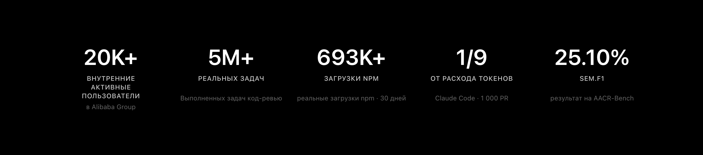
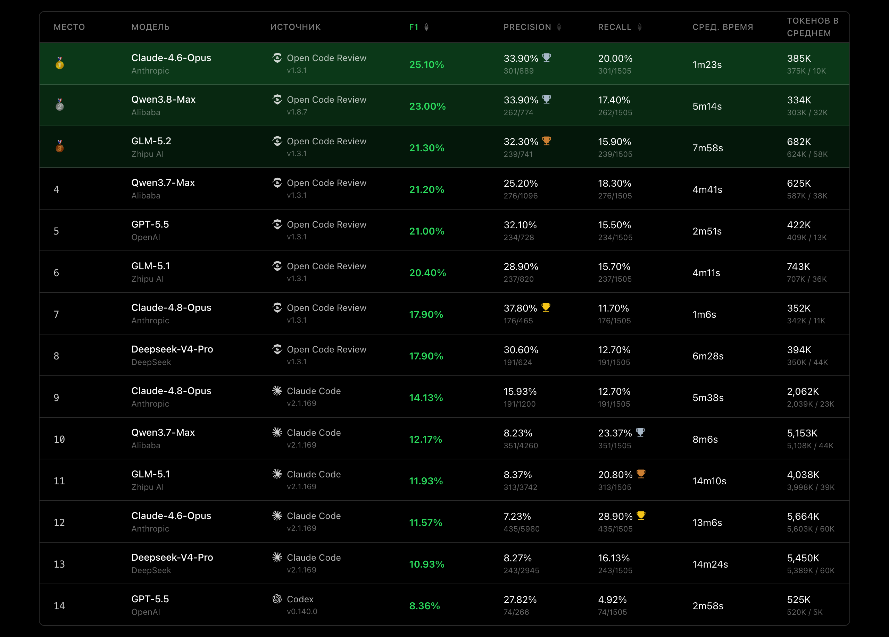
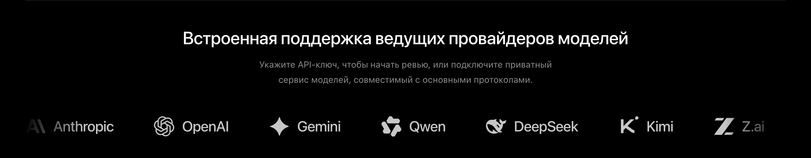

<div align="center">
  <a href="https://open-codereview.ai">
    
  </a>
  <h1>OpenCodeReview</h1>
</div>

<p align="center">
  <a href="https://trendshift.io/repositories/41087?utm_source=repository-badge&amp;utm_medium=badge&amp;utm_campaign=badge-repository-41087" target="_blank" rel="noopener noreferrer">
    
  </a>
</p>
<p align="center">
  <a href="https://trendshift.io/repositories/41087" target="_blank">
    
  </a>
  <a href="https://trendshift.io/repositories/41087" target="_blank">
    
  </a>
</p>
<p align="center">
  <a href="https://www.npmjs.com/package/@alibaba-group/open-code-review"></a>
  <a href="https://github.com/alibaba/open-code-review/actions/workflows/release.yml"></a>
  <a href="https://github.com/alibaba/open-code-review/blob/main/LICENSE"></a>
  <a href="https://deepwiki.com/alibaba/open-code-review"></a>
  <a href="https://www.bestpractices.dev/projects/13328"></a>
</p>
<p align="center">
  <a href="#supported-platforms"></a>
  <a href="#supported-platforms"></a>
  <a href="#supported-platforms"></a>
  <a href="#supported-agents"></a>
  <a href="#supported-agents"></a>
  <a href="#supported-agents"></a>
  <a href="#supported-agents"></a>
</p>
<p align="center">
  <a href="../../README.md">English</a> | <a href="README.zh-CN.md">简体中文</a> | <a href="README.ja-JP.md">日本語</a> | <a href="README.ko-KR.md">한국어</a> | Русский
</p>

---

## 什么是 Open Code Review？

Open Code Review 是一款基于 AI 的代码审查 CLI 工具。它最初是阿里巴巴集团内部官方的 AI 代码审查助手：过去两年间，已有数万名开发者使用它，在代码中发现了数百万个缺陷。经过大规模严格验证后，我们将其开源给社区。只需配置模型端点即可开始使用。

该工具读取 git diff，通过支持工具调用（tool use）的智能体，将变更文件发送给可配置的 LLM，并生成精确到行的结构化审查评论。智能体可以读取文件完整内容、搜索代码库、查看其他变更文件以获取上下文，并执行深度审查——而不只是对 diff 给出表面意见。除审查 diff 外，`ocr scan` 还支持整文件检查——适用于审计不熟悉的代码库或没有显著 diff 的目录。

更多信息请访问[官方网站](https://open-codereview.ai)。



## 基准测试

> 与通用智能体（Claude Code）相比，Open Code Review 在相同基础模型下，**Precision** 和 **F1** 显著更高，仅消耗 **约 1/9 的 token**，审查速度更快。但 Recall 低于通用智能体——这是为追求精确性和最小噪声而做出的有意权衡。

基准测试基于真实代码审查构建，涵盖 **50** 个热门开源仓库、**200** 个真实 Pull Request 和 **10** 种编程语言。**1 505** 个缺陷的标注由 80 多位资深工程师交叉审核。

<a href="https://huggingface.co/datasets/Alibaba-Aone/aacr-bench"> 在 Hugging Face 上打开 AACR-Bench 数据集</a>。

| 指标 | 衡量内容 | 为何重要 |
|---------|-------------|--------------|
| **F1** | precision 和 recall 的调和平均 | 衡量审查质量的最佳单一指标 |
| **Precision** | 发现的问题中真实缺陷的占比 | 越高 = 误报越少 |
| **Recall** | 真实缺陷中被发现的占比 | 越高 = 遗漏越少 |
| **Avg Time** | 单次审查的执行时间 | 影响 CI 流水线的延迟 |
| **Avg Token** | 单次审查的总 token 消耗 | 直接影响 API 成本 |



## 为什么选择 Open Code Review？

### 通用智能体的问题

如果你曾使用通用智能体（如 Claude Code 配合 Skills）进行代码审查，很可能遇到过以下问题：

- **覆盖不完整**——面对大型变更集，智能体倾向于"偷工减料"：只抽查部分文件，遗漏其余文件。
- **位置漂移**——发现的问题往往与代码中的实际位置不符：行号和文件引用偏离目标。
- **质量不稳定**——由自然语言驱动的 Skills 难以调试，提示词稍有变化，审查质量就明显波动。

根本原因：纯语言架构无法对审查过程施加硬性约束。

### 核心理念：确定性工程 × 智能体

Open Code Review 的核心理念是将确定性工程与智能体相结合，让各自发挥所长。

**确定性工程——硬性保障**

对于审查中*绝不能出错*的步骤，正确性由工程逻辑保证，而非语言模型：

- **精确的文件筛选**——准确判断哪些文件需要审查、哪些应过滤，确保不遗漏任何重要变更。
- **关联文件分组**——将关联文件合并为一个审查单元（例如 `message_en.properties` 和 `message_zh.properties`）。每组由独立子智能体在隔离上下文中处理。"分而治之"的方式在超大变更下保持稳定，并支持并行审查。
- **精确的规则匹配**——根据每个文件的特性匹配审查规则，让模型专注于任务，消除多余的信息噪声。基于模式的匹配比仅用自然语言管理规则更稳定、更可预测。
- **外部定位与反思模块**——独立的评论定位模块和评论反思模块，系统性提升 AI 评论的位置和内容准确性。

**智能体——动态决策**

智能体的优势集中在最关键之处——动态决策和动态补充上下文：

- **场景化提示词**——针对代码审查深度优化的提示词模板：质量更高，token 消耗更少。
- **专用工具集**——基于真实项目中工具调用分析构建：调用频率、各工具重复调用占比以及新工具对整条链路的影响。该工具集在代码审查中比通用智能体工具更稳定、更可预测。

## 如何使用

### 前置要求

- **Git >= 2.41**——Open Code Review 使用 Git 生成 diff、搜索代码和执行仓库操作。

<a id="supported-agents"></a>

### Agent Skills

技能可在 Claude Code、Codex、Cursor、Kimi Code 及其他支持 Agent Skills 和本地命令执行的智能体中运行。两种模式均需 **Git >= 2.41** 和 **`ocr` CLI**；OCR 中的模型提供商仅在原生模式下需要。

#### 1. 安装技能

在待审查项目中执行以下命令，在安装器中选择所需技能和你的智能体：

```bash
npx skills add alibaba/open-code-review
```

如果 `ocr` 不存在，技能会提示智能体根据环境权限安装它。也可以预先安装：`npm install -g @alibaba-group/open-code-review`。插件和手动安装方式请参阅[智能体说明](../../plugins/open-code-review/README.md)，或将 [`skills/`](../../skills/) 中所需文件夹复制到智能体的技能目录。

#### 2. 选择审查模式

| | 原生模式 | 委托模式 |
|---|---|---|
| 技能 | [`open-code-review`](../../skills/open-code-review/SKILL.md) | [`open-code-review-delegate`](../../skills/open-code-review-delegate/SKILL.md) |
| 谁来审查？ | OCR 专用智能体和流水线 | 当前智能体，遵循 OCR 的审查流水线和防护约束 |
| 模型与认证 | OCR 自身的提供商设置 | 宿主智能体已配置的模型和认证 |
| 何时选择 | 有 OCR 的模型端点，需要完整审查流水线 | 没有独立 API 密钥，或希望使用现有订阅和智能体设置 |

**没有独立密钥？从委托模式开始。** 它无需配置 OCR 提供商，但宿主智能体的认证、限额和费用仍然适用。智能体订阅不会自动成为原生模式的 API 凭据。委托模式下，OCR CLI 和技能共同提供审查流水线和防护约束：文件筛选、规则解析、覆盖要求和结构化报告。宿主智能体在此流程内完成分析、行号绑定和报告；完整的 OCR 原生流水线不会运行。

原生模式需执行一次 `ocr config provider` 和 `ocr config model`。认证要求因提供商而异；请参阅[配置](https://open-codereview.ai/docs/configuration)。

### CLI

#### 安装

```bash
npm install -g @alibaba-group/open-code-review
```

安装后 `ocr` 命令全局可用。

其他安装方式（安装脚本、GitHub Release 二进制文件、从源码构建）请参阅[安装指南](https://open-codereview.ai/docs/installation)。

#### 快速开始

**1. 配置 LLM**

开始审查前必须配置 LLM，除非使用[委托模式](https://open-codereview.ai/docs/delegate)。

- **由 OCR 调用模型：** `ocr review`、`/open-code-review:review` 命令和 `open-code-review` 技能使用 OCR 中的提供商设置，而非 Claude Code Team/Pro 订阅授权。认证要求因提供商而异；请参阅[配置指南](https://open-codereview.ai/docs/configuration)。
- **由宿主智能体调用模型：** `/open-code-review:delegate-review` 命令和 `open-code-review-delegate` 技能使用宿主智能体中配置的模型和认证方式。无需在 OCR 中单独配置 LLM 或凭据。请参阅 [Claude Code 安装说明](../../plugins/open-code-review/README.md#claude-code)。

```bash
ocr config provider          # 选择内置提供商或添加自定义提供商
ocr config model             # 为当前提供商选择模型
```



交互式 UI 会引导你选择提供商、输入 API 密钥并配置模型，随后自动验证连接。

通过 CLI 配置、环境变量、自定义提供商及其他高级参数请参阅[配置指南](https://open-codereview.ai/docs/configuration)。

**2. 开始审查**

```bash
cd your-project

# 工作区模式——审查所有已暂存、未暂存和未跟踪的变更
ocr review

# 当前分支——审查自分支从 main 分离以来的变更（--to 默认为 HEAD）
ocr review --from main

# 分支范围——审查 feature-branch 从 main 分离以来的变更（merge-base 模式）
ocr review --from main --to feature-branch

# 单个提交
ocr review --commit abc123

# 恢复中断的范围审查或单提交审查
ocr session list
ocr review --from main --to feature-branch --resume <session-id>

# 整文件扫描——审查完整文件而非 diff（无需 git 历史）
ocr scan                          # 扫描整个仓库
ocr scan --path internal/agent    # 扫描目录或指定文件
ocr scan --resume <session-id>   # 恢复中断的整文件扫描

# 将结果保存到文件（推荐用于 AI 宿主智能体）
ocr review --format json --output result.json

# 委托模式——由 AI 智能体自行执行审查
# OCR 负责文件筛选和规则解析；无需配置 LLM
ocr delegate preview
ocr delegate rule src/main.go src/handler.go
```

## 文档

完整文档请访问 **[open-codereview.ai/docs](https://open-codereview.ai/docs)**：

- [快速开始](https://open-codereview.ai/docs/quickstart)——安装并运行首次审查
- [安装](https://open-codereview.ai/docs/installation)——所有平台和包管理器
- [CLI 参考](https://open-codereview.ai/docs/cli-reference)——所有命令和参数
- [审查规则](https://open-codereview.ai/docs/review-rules)——自定义审查规则、过滤和按路径定向
- [配置](https://open-codereview.ai/docs/configuration)——配置项和环境变量
- [MCP 服务器](https://open-codereview.ai/docs/mcp)——用外部工具扩展审查智能体
- 编码智能体集成——选择你使用的平台
  - [Claude Code](../../plugins/open-code-review/README.md#claude-code)——安装带审查斜杠命令的插件
  - [Codex](../../plugins/open-code-review/README.md#codex)——安装带可调用审查技能的插件
  - [Cursor](../../plugins/open-code-review/README.md#cursor)——安装带可移植审查技能的插件
  - [Kimi Code](../../plugins/open-code-review/README.md#kimi-code)——安装带斜杠命令和审查技能的插件
  - [OpenCode](../../plugins/open-code-review/opencode/README.md)——安装原生审查工具和斜杠命令
  - [QCA Forward](../../plugins/open-code-review/qca/README.md)——使用 QCA 宿主模型和可发布模板运行委托模式
  - [支持 Skill 的智能体](https://open-codereview.ai/docs/agent-skill)——安装可移植智能体技能
- 审查执行模式——集成后选择由哪个 LLM 执行审查
  - [默认（由 OCR 管理）](https://open-codereview.ai/docs/configuration)——OCR 使用已配置的 LLM 执行审查
  - [委托模式](https://open-codereview.ai/docs/delegate)——编码智能体使用自身 LLM 执行审查；无需 OCR API 密钥
- [CI/CD 集成](https://open-codereview.ai/docs/cicd)——GitHub Actions、GitLab CI、GitFlic CI 和 Gerrit
- [会话查看](https://open-codereview.ai/docs/viewer)——在浏览器中查看和回放审查会话，将评论标记为已修复/已忽略并隐藏
- [遥测](https://open-codereview.ai/docs/telemetry)——OpenTelemetry 可观测性集成
- [FAQ](https://open-codereview.ai/docs/faq)——常见问题和故障排除

## 参与贡献

本项目的存在离不开每一位贡献者。[CONTRIBUTING.ru-RU.md](CONTRIBUTING.ru-RU.md) 中介绍了开发环境搭建、代码规范和 Pull Request 提交流程。

<a href="https://github.com/alibaba/open-code-review/graphs/contributors">
  
</a>

## 许可证

[Apache-2.0](../../LICENSE) — Copyright 2026 Alibaba