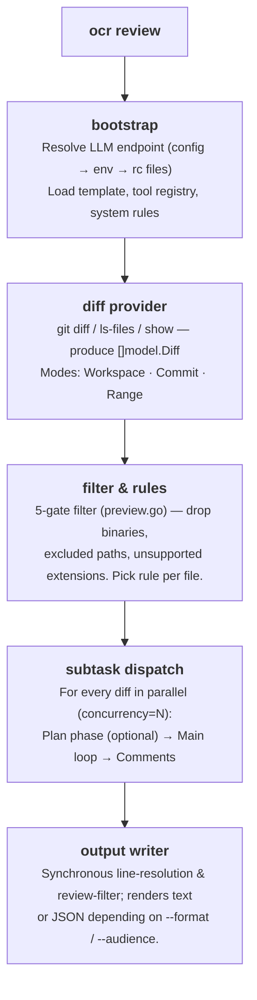
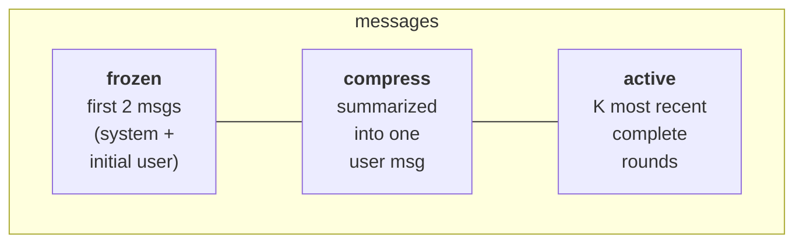

本指南将介绍从你按下 Enter 键到 JSON 输出到终端的过程中，`ocr review` 在内部实际是如何运作的。旨在帮助你构建足够的心智模型，以便调试行为、调整参数，并自信地阅读源代码。

## 高层流水线



编排逻辑位于 [`internal/agent/`](https://github.com/alibaba/open-code-review/blob/main/internal/agent/) 包中，分为四个文件：`agent.go`（主循环与调度）、`compression.go`（内存压缩）、`preview.go`（文件过滤）、`util.go`（辅助函数）。有两个值得关注的入口点：`Agent.Run`（流水线的最顶层）和 `Agent.dispatchSubtasks`（按文件进行扇出）。

## diff provider

`internal/diff/git.go` 定义了 `Provider` 结构体，其未导出的字段 `mode`（类型为 `Mode`，一个 `int` 枚举）会选择与 CLI 参数对应的三种模式之一：

| 模式 | 触发方式 | 返回内容 |
|---|---|---|
| `Workspace` | 无参数 | 已暂存 + 未暂存 + 未跟踪的更改 |
| `Commit` | `--commit <sha>` / `-c <sha>` | `<sha>` 引入的更改（通过 `git show <sha>`，相当于 `<sha>^..<sha>` 的 diff） |
| `Range` | `--from <a> --to <b>` | `merge-base(a, b)..b` |

每个 diff 包含：旧/新路径、旧/新 hunk、插入/删除计数、二进制标志、重命名检测。`DiffContextLines` 固定为 **3**，与 Git 默认值一致。

未跟踪的文件会从磁盘读取，并作为整个文件的新增内容处理，因此可以在提交前进行审查。

## 5 级门控的文件过滤

读取 diff 后，每个文件都会通过 [`whyExcluded`](https://github.com/alibaba/open-code-review/blob/main/internal/agent/preview.go) 函数。该函数返回以下任一结果：

```
binary          — file is binary
user_exclude    — matched a pattern in your `exclude` list
unsupported_ext — extension is not in supported_file_types.json
default_path    — matched a built-in test-file exclude pattern
```

……或者如果文件被保留，则返回空值。`deleted` **不会**从 `whyExcluded` 返回。它是在 `Preview()` 中后续计算的，当保留文件的 diff 报告 `IsDeleted` 时。每个门控按以下顺序执行：

1. `binary`：二进制文件首先被丢弃。
2. `user_exclude`：你项目的 `exclude` 始终优先。
3. `user_include`：如果设置了 include 模式**并且**文件匹配其中任何一个，则立即保留（返回空值），并绕过下面的 `unsupported_ext` 和 `default_path` 门控。
4. `unsupported_ext` 使用扩展名白名单进行过滤。
5. `default_path` 是最后一个门控：匹配内置的**测试文件**排除模式（`**/*_test.go`、`**/*.test.{js,jsx,ts,tsx}`、`**/__tests__/**`、`**/*_test.py`、`**/*_spec.rb`、`**/*.test.ets`……）。每个模式都带有 `**/` 作为根前缀。

噪声目录的过滤（`vendor/`、`node_modules/`、`target/`……）发生在更早的阶段，即 diff-provider 层，通过 `internal/diff/git.go` 中的 `providerDirIgnoreDirs` 列表实现。这些目录的 diff 在解析后会被 `filterDiffs` 移除，永远不会到达逐文件过滤器。

运行 `ocr review --preview` 可以在不消耗 token 的情况下查看完整的过滤结果。完整算法请参阅[审查规则](../review-rules/#how-files-are-filtered)。

## 逐文件子任务：plan + main

对于每个通过过滤的文件，OCR 会启动一个子代理。每个子代理在自己的 goroutine 中运行，受 `--concurrency`（默认 **8**）限制，并拥有独立的 LLM 消息缓冲区。

一个子任务最多包含**两个阶段**：

### 阶段 1：Plan（可选）

```go
threshold := template.PlanModeLineThreshold     // 50
changeLines := d.Insertions + d.Deletions
if changeLines < threshold { skip plan }
```

对于较小的 diff，plan 只会增加延迟而没有价值，因此会被静默跳过，直接执行 main 循环。对于较大的 diff，OCR 会**仅一次**调用 `PLAN_TASK` 的 LLM。由于不发送 `Tools` 字段，模型在 plan 期间无法调用工具。只读工具的子集（`code_search`、`file_read_diff`、`file_find`，即 `tools.json` 中 `plan_task` 标志为 `true` 的三个工具）会通过 `{{plan_tools}}` 占位符（由 `formatToolDefs` 渲染）以纯文本形式嵌入，告知模型稍后可以使用哪些工具。模型返回一个检查清单，该清单会成为 main prompt 中的 `{{plan_guidance}}`。

### 阶段 2：main 循环

main 循环组装 `MAIN_TASK` prompt，并展开模型与工具调用之间的交互。完整的工具集是在 plan 阶段的工具基础上，加上 **`task_done`**、**`code_comment`** 和 **`file_read`**。完整列表请参阅[工具](../tools/)。

```
loop up to MAX_TOOL_REQUEST_TIMES (default 30):
    response = llm.complete(messages, tools)
    if response.toolCalls is empty:
        nudge model with "You did not successfully call any tools.
                          Please try again or use task_done if finished."
        continue
    for each call: execute → collect result
    if any call was task_done: break
    addNextMessage(...)              # may trigger compression
```

循环有 5 个退出条件：

1. 调用了 `task_done`。
2. 用尽了 `MAX_TOOL_REQUEST_TIMES`。
3. 连续 3 轮未产生有效的工具结果（`maxConsecutiveEmptyRounds = 3`）。
4. context 被取消。
5. `addNextMessage` 返回 false。即压缩后仍无法将消息缓冲区降至警告阈值以下。

在任何情况下，已收集的 `code_comment` 调用都会成为审查评论。

## 内存压缩

长时间的工具调用循环最终会使上下文窗口溢出。OCR 采用**三分区**策略进行管理，由 `MAX_TOKENS = 58888` 定义的 token 预算触发：

| 阈值 | 常量 | 行为 |
|---|---|---|
| MAX_TOKENS 的 60% | `tokenSoftThreshold` | 启动**异步**的后台压缩。当前循环不中断，继续执行。 |
| MAX_TOKENS 的 80% | `tokenWarningThreshold` | 在发送下一个请求前**同步**执行压缩。 |

### 三个区域



1“轮”指的是一个 assistant 消息及其后续的工具结果消息。`partitionMessages` 从末尾向前遍历轮次，保留尽可能多的轮次，使其适应 `(0.80 × MAX_TOKENS) - reservedTokens`。更早的内容则进入 **compress 区域**。

compress 区域被渲染为 XML，并通过 `MEMORY_COMPRESSION_TASK` prompt 传递给模型。返回的摘要会被包裹在 `<previous_review_summary>` 标签中，并追加到原始 user 消息中。

压缩后：`messages = frozen[2] + compressed_user_msg + active`。

```go
// compression.go
func (a *Agent) runCompression(ctx context.Context, msgs []llm.Message, filePath string) ([]llm.Message, error) {
    part := partitionMessages(msgs, a.args.Template.MaxTokens, 0)
    contextXML := buildMessageXML(msgs[part.frozenEnd:part.compressEnd])
    // … 调用 MEMORY_COMPRESSION_TASK …
    rebuilt[1] = llm.NewTextMessage(role, currentText+
        "\n\n<previous_review_summary>\n"+rawSummary+"\n</previous_review_summary>")
    for i := part.compressEnd; i < len(msgs); i++ {
        rebuilt = append(rebuilt, msgs[i])
    }
    return rebuilt, nil
}
```

### 异步 vs 同步

在异步路径中，后台执行压缩的同时，main 循环可以继续生成工具调用。当下一次 token 检查发生时，准备好的摘要会通过 `tryApplyPendingCompression` 应用。如果在异步任务完成之前比例超过了警告阈值，循环会暂停并同步执行 `runCompression`。这保证了下一个请求必定能够适应。

## 评论处理流水线

每个 `code_comment` 工具调用会生成一个或多个原始评论。它们会通过 **CommentWorkerPool**（固定大小的 goroutine 池），以防止主工具调用循环在后处理时被阻塞：

1. **行解析**（在 worker 内）：使用滑动窗口算法将 `existing_code` 与 diff 进行匹配，计算精确的 `start_line` / `end_line`。如果匹配失败，两者都默认为 `0`。行范围 `0` 是“未锚定”评论的隐式信号，需要用户手动定位（不存储标志；下游消费者检查 `start_line == 0`）。
2. **重定位任务** *（可选的回退）*：当行解析在更复杂的 diff 上失败时，OCR 会执行 `RE_LOCATION_TASK` prompt，要求模型重新锚定代码片段。这对于重写的 `existing_code` 字符串很有用。
3. **审查过滤器**：在 main 循环结束后（worker 池清空后），`REVIEW_FILTER_TASK` 的 LLM 调用会对照 diff 检查收集到的评论，并删除可被证明明显错误的评论。此处的错误会被记录并忽略。
4. **第二次行解析**：在 `Agent.Run` 返回后，顶层命令会对完整的评论集重新执行 `diff.ResolveLineNumbers`（参见 `cmd/opencodereview/review_cmd.go`）。这是为了捕获 `existing_code` 跨多个文件或在重定位步骤中被更新的评论。
5. **渲染**：根据 `--format` 渲染为文本或 JSON。

## token 预算保护

在调用 LLM 之前，OCR 首先进行快速失败的检查：

```go
tokenLimit := MaxTokens * 4 / 5     // 80 %
if countMessagesTokens(messages) > tokenLimit {
    record warning "token_threshold_exceeded"
    return nil      // skip this file
}
```

这可以防止巨大的 diff（自动生成的锁文件、触及数千行的重构）在消耗请求之前就被拦截。被跳过的文件会作为非致命警告报告到 stdout，并添加到 JSON 的 `warnings` 数组中。

第二个检查在 `filterLargeDiffs` 中执行：如果 diff 单独超过 `MAX_TOKENS` 的 80%，它会在逐文件调度器启动之前被过滤掉。

## 模板与占位符

`internal/config/template/task_template.json` 包含 **5 个 prompt**：

| Key | 用途 |
|---|---|
| `PLAN_TASK` | plan 阶段。生成检查清单。 |
| `MAIN_TASK` | main 审查循环。发出 `code_comment` 调用。 |
| `MEMORY_COMPRESSION_TASK` | 总结 compress 区域。 |
| `REVIEW_FILTER_TASK` | 循环后，删除可被证明明显错误的评论。 |
| `RE_LOCATION_TASK` | 重新锚定无法匹配 `existing_code` 的评论。 |

每个 prompt 是一个 `{role, prompt_file}` 引用的列表，指向模板目录中的 `.md` 文件（例如：`{"role": "system", "prompt_file": "main_task_system.md"}`）。加载时，`resolveConversation` 会将这些文件读入内存中的 `{role, content}` 消息，然后模板占位符会按文件进行解析：

| 占位符 | 替换内容 |
|---|---|
| `{{system_rule}}` | 从 4 层链解析出的规则正文。 |
| `{{change_files}}` | PR 中其他每个更改文件的状态 + 路径。 |
| `{{diff}}` | 此文件的 diff（原始 `git diff` 输出）。 |
| `{{current_file_path}}` | 此文件的新路径。 |
| `{{plan_guidance}}` | plan 阶段的输出。如果 plan 被跳过，则删除。 |
| `{{plan_tools}}` | plan 阶段工具定义的纯文本（由 `formatToolDefs` 渲染）。用于 `PLAN_TASK` 的 system prompt。 |
| `{{requirement_background}}` | `--background` 参数的内容。 |
| `{{current_system_date_time}}` | 运行时的本地时间戳。格式为 `YYYY-MM-DD HH:MM`（无秒或时区）。 |
| `{{context}}` | （仅压缩时）要总结的 XML 渲染消息。 |
| `{{path}}` | 文件路径。用于 `REVIEW_FILTER_TASK`。 |
| `{{comments}}` | 累积的评论（JSON）。用于 `REVIEW_FILTER_TASK`。 |

占位符替换位于 [`agent.go`](https://github.com/alibaba/open-code-review/blob/main/internal/agent/agent.go) 中。模板本身无法通过 CLI 覆盖。要修改 prompt，你需要编辑 [`task_template.json`](https://github.com/alibaba/open-code-review/blob/main/internal/config/template/task_template.json) 并重新构建。`--tools` 参数是*工具注册表*的覆盖（替换 `internal/config/toolsconfig` 消费的 JSON），而不是模板覆盖。请参阅[工具](../tools/#customizing-tools)。

> **关于占位符语法的说明。** 上述所有占位符都使用双花括号 `{{…}}` 语法。*但是* `RE_LOCATION_TASK` 是个例外，它替换单花括号的 `{diff}`、`{existing_code}` 和 `{suggestion_content}`（参见 `internal/diff/relocation.go`）。

## 持久化

每次审查都会以 JSONL 格式写入磁盘：

```
~/.opencodereview/sessions/<encoded-repo-path>/<session-id>.jsonl
```

仓库路径**不会**进行 base64 编码。`encodeRepoPath`（位于 `internal/session/persist.go`）将 `/` 和 `\` 替换为 `-`，将 `:` 替换为 `_`，使路径在文件系统中安全。

每行是一个事件：发送的 prompt、LLM 响应、工具调用、工具结果、发出的评论等。Web UI（`ocr viewer`）直接读取这些文件。没有数据库，只有 append-only 的日志。UI 指南和事件 schema 请参阅[会话查看器](../viewer/)。

## 遥测

启用遥测后，agent 会发出 3 个流水线级别的 span（`review.run` 包裹整个作业，`diff.parse` 包裹 diff 的读取，每个被审查的文件对应一个 `subtask.execute.<file>`）。此外，在每个决策点会发出短生命周期的 `event.<name>` span（`plan.skipped`、`token.threshold.exceeded`、`subtask.error`……）。LLM 往返和工具调用仅作为 metrics 记录，不作为 span 记录。prompt 和响应内容**绝不会**附加到遥测中。`OCR_CONTENT_LOGGING` 标志已接线，但目前是死代码。完整 schema 请参阅[遥测](../telemetry/)。

## *不自动化*的部分

某些决策有意保持手动：

- **端点发现没有回退。** 如果 config + env + rc 文件无法提供完整的 `(URL, token, model)` 三元组，OCR 会以非零代码退出，而不是猜测。
- **子代理失败是隔离的，不会重试。** 一个失败的文件产生一个警告，其余文件继续。重试是外层 CI 流水线的责任，而非 agent 的责任。
- **没有跨文件推理。** 每个文件都在其自己的 LLM 对话中审查。跨文件的问题通过 `file_read_diff` / `code_search` 工具调用处理，不使用共享上下文。也禁止评论在*其他*文件中发现的问题。`main_task` prompt 指示模型仅将上下文工具用于理解，并忽略当前 diff 之外文件中发现的问题。

这些选择使