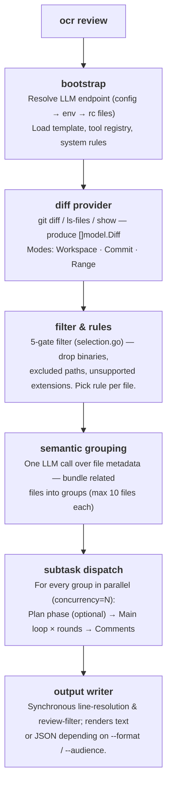
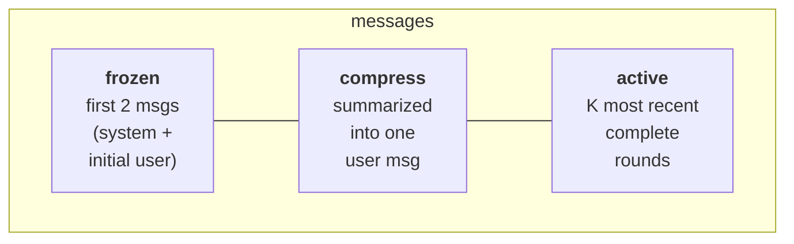

本文介绍从你按下 Enter 键到 JSON 输出到终端之间，`ocr review` 内部的实际运作方式。目标是帮你建立足够的心智模型，以便调试行为、调整参数，并有信心阅读源码。

## 高层流水线



编排逻辑位于 [`internal/agent/`](https://github.com/alibaba/open-code-review/tree/main/internal/agent/) 包，主要文件有 `agent.go`（调度与按组编排）、`grouping.go`（语义化文件分组）、`selection.go`（文件过滤）、`preview.go`（`--preview` 报告）、`util.go`（辅助函数）。工具调用循环与内存压缩位于相邻的 [`internal/llmloop/`](https://github.com/alibaba/open-code-review/tree/main/internal/llmloop/)。两个关键入口：`Agent.Run`（流水线最顶层）和 `Agent.dispatchSubtasks`（按组扇出）。

## diff provider

`internal/diff/git.go` 定义了 `Provider` 结构体，其未导出字段 `mode`（类型为 `Mode`，`int` 枚举）选择三种模式之一，对应 CLI 参数：

| 模式 | 触发方式 | 返回内容 |
|---|---|---|
| `Workspace` | 无参数 | staged + unstaged + untracked 的变更 |
| `Commit` | `--commit <sha>` / `-c <sha>` | `<sha>` 引入的变更（经 `git show <sha>`，等价于 `<sha>^..<sha>` 的 diff） |
| `Range` | `--from <a> --to <b>` | `merge-base(a, b)..b` |

每个 diff 保留：old/new path、old/new hunk、插入/删除计数、二进制标志、重命名检测。`DiffContextLines` 固定为 **3**，与 Git 默认一致。

untracked 文件从磁盘读取，作为整文件新增处理，因此可在提交前审查。

## 五道关卡的文件过滤

读取 diff 后，每个文件经过 [`whyExcluded`](https://github.com/alibaba/open-code-review/blob/main/internal/agent/selection.go)，该函数返回以下之一：

```
binary          — file is binary
user_exclude    — matched a pattern in your `exclude` list
unsupported_ext — extension is not in supported_file_types.json
default_path    — matched a built-in test-file exclude pattern
```

……或文件被保留时返回空。`deleted` 和 `too_large` **不会**由 `whyExcluded` 返回，它们由关卡之后的 `selectFiles` 应用：`deleted` 在保留文件的 diff 报告 `IsDeleted` 时触发，`too_large` 在 diff 单独超过 `max_tokens` 的 80% 时触发。各关卡按以下顺序执行：

1. `binary`：二进制文件最先丢弃。
2. `user_exclude`：项目 `exclude` 始终优先。
3. `user_include`：若配置了 include 模式**且**文件匹配其中之一，立即保留（返回空），跳过下面的 `unsupported_ext` 和 `default_path` 关卡。
4. `unsupported_ext` 按扩展名白名单过滤。
5. `default_path` 是最后一道关卡：匹配内置的**测试文件**排除模式（`**/*_test.go`、`**/*.test.{js,jsx,ts,tsx}`、`**/__tests__/**`、`**/*_test.py`、`**/*_spec.rb`、`**/*.test.ets`……）。每个模式都加 `**/` 作为根前缀。

噪声目录过滤（`vendor/`、`node_modules/`、`target/`……）发生在更早的 diff-provider 层，通过 `internal/diff/git.go` 的 `providerDirIgnoreDirs` 列表实现。这些目录的 diff 解析后即被移除，不会到达按文件过滤。Preview 将其报告为 `provider_directory`。`include` 规则无法将它们重新纳入审查。

该列表按路径前缀匹配，因此只作用于**仓库根目录**下的目录。嵌套的同名目录会到达按文件过滤，并被 `default_path` 排除。`vendor/pkg/x.go` 报告为 `provider_directory`，`api/vendor/pkg/x.go` 报告为 `default_path`，只有后者能通过 `include` 规则恢复。

运行 `ocr review --preview` 可在不消耗 token 的情况下查看完整过滤结果。完整算法见[审查规则](../review-rules/#how-files-are-filtered)。

## 语义化文件分组

过滤后，OCR 先发起一次 `GROUPING_TASK` 的 LLM 调用（`internal/agent/grouping.go`）。发送给模型的只有**文件元数据**（路径、状态、`+`/`-` 行数），不含 diff 内容。模型据此将语义相关的文件归为一组，以便一起审查。典型同组情况：同一模块/功能的文件、生产者与消费者关系（接口与实现）、同一资源的 i18n/配置变体、同一目录下为同一目的协作的文件。

约束与回退：

- 每个文件恰好属于一个组。每组上限为 `maxFilesPerGroup = 10` 个文件。
- 若组内 diff 总 token 超限，该组拆分为单文件组（`enforceGroupTokenBudget`）。
- 若分组调用失败、返回空响应，或只有一个文件，则回退为**每文件一组**的调度。

## 按组子任务：plan + main

对每个文件组，OCR 启动一个子代理。每个子代理在自己的 goroutine 中运行，受 `--concurrency`（默认 **8**）限制，拥有独立的 LLM 消息缓冲区。

一个子任务最多有**两个阶段**：

### 阶段 1：Plan（可选）

```go
// template.PlanRequired(fileCount, totalChanged, maxFileChanged)
PlanModeLineThreshold      = 50    // グループ内の単一ファイルの最大変更行数
PlanModeGroupLineThreshold = 100   // 複数ファイルグループの合計変更行数

if maxFileChanged >= 50                      { run plan }   // 单文件大改动
if fileCount >= 2 && totalChanged >= 100     { run plan }   // 多文件中等改动
otherwise                                    { skip plan }
```

两个阈值协同工作：`PLAN_MODE_LINE_THRESHOLD` 看组内最大文件，`PLAN_MODE_GROUP_LINE_THRESHOLD` 看整组合计变更量。后者刻意设得较大，以避免 plan 阶段无条件执行。

小 diff 执行 plan 只会增加延迟而无价值，因此静默跳过，直接运行 main 循环。较大 diff 下，OCR **只发起一次** `PLAN_TASK` 的 LLM 调用。由于不发送 `Tools` 字段，plan 期间模型无法调用工具。只读工具子集（`code_search`、`file_read`、`file_read_diff`、`file_find`，由 `task_template.json` 的 `PLAN_TASK.tool_references` 选择）通过 `{{plan_tools}}` 占位符（由 `formatToolDefs` 渲染）以纯文本嵌入，告知模型后续可用工具。模型返回检查清单，成为 main prompt 中的 `{{plan_guidance}}`。

### 阶段 2：main 循环（多轮）

main 循环组装 `MAIN_TASK` prompt，展开模型与工具的调用对话。完整工具集为 plan 阶段的工具引用加上 **`task_done`** 和 **`code_comment`**。完整列表见[工具](../tools/)。

整个 main 循环最多重复 `MAX_REVIEW_ROUNDS` 次（由 `--effort` 控制：`low` = 1 轮，`medium` = 2 轮（默认），`high` = 3 轮）。第 2 轮起移除 plan 结果（避免其成为召回上限），并将前几轮确定的评论作为"已发现的指摘"上下文传入，让模型寻找**新**问题。若某轮未产生新指摘，或确定评论数达到上限，则提前停止。

```
loop up to MAX_TOOL_REQUEST_TIMES (default 100):
    response = llm.complete(messages, tools)
    if response.toolCalls is empty:
        nudge model with "You did not successfully call any tools.
                          Please try again or use task_done if finished."
        continue
    for each call: execute → collect result
    if any call was task_done: break
    addNextMessage(...)              # may trigger compression
```

循环有 5 个终止条件：

1. 调用了 `task_done`。
2. 用尽 `MAX_TOOL_REQUEST_TIMES`。
3. 连续 3 轮未产生有效工具结果（`maxConsecutiveEmptyRounds = 3`）。
4. context 被取消。
5. `addNextMessage` 返回 false，即压缩后仍无法将消息缓冲区降到警告阈值以下。

任何情况下，已收集的 `code_comment` 调用都会成为审查评论。

## 内存压缩

长工具调用循环最终会撑爆上下文窗口。OCR 用**三段式**策略管理，由 `MAX_TOKENS = 200000` 定义的 token 预算触发。注意 `MAX_TOKENS` 只是**prompt** 上限；模型输出上限由另一个 `MAX_COMPLETION_TOKENS = 16384` 控制，因此用 `--max-tokens` 提高 prompt 上限不会同时扩大输出预算。

| 阈值 | 常量 | 行为 |
|---|---|---|
| MAX_TOKENS 的 60% | `tokenSoftThreshold` | 启动**异步**后台压缩，当前循环不中断继续运行。 |
| MAX_TOKENS 的 80% | `tokenWarningThreshold` | 在发送下一个请求前**同步**执行压缩。 |

在选择保留在 active 区的轮次之前，OCR 会预留摘要正文的空间。预留量为以下三者的最小值：配置的输出上限、上下文窗口的 20%、扣除固定 prompt 与包装后的剩余空间。由于部分提供方将推理 token 也计入输出，若压缩请求本身在 80% 警告阈值下仍有余量，则在配置的输出上限范围内增加生成预算，并要求正文控制在预留量以内。重建后的对话大小另行检查。这些限制独立于累计预算 `--max-tokens-budget`，将累计预算设为零也不会禁用压缩。

### 三个区



一个"轮次"指一条 assistant 消息及其后续的工具结果消息。`partitionMessages` 从末尾向前遍历轮次，在 token 数严格低于 `(0.80 × MAX_TOKENS) - reservedTokens` 的范围内保留尽可能多的轮次。预留预算包括前 2 条消息（含之前的摘要）、新摘要正文的预留量及其包装。更早的内容成为 **compress 区**。若 compress 区为空，则不修改对话。此外，若原始对话仍低于警告阈值，后台压缩不会将固定前缀之后的全部轮次一并摘要。

compress 区渲染为 XML，通过 `MEMORY_COMPRESSION_TASK` prompt 传给模型。返回的摘要用 `<previous_review_summary>` 标签包裹，追加到原始 user 消息内。

压缩后：`messages = system + (original_user + summary) + active`。
重建后的对话用相同的本地 token 估算方法检查，必须小于原始对话。若缺少压缩模板、摘要为空，或结果未变小，则保留原始历史。若摘要模板不可用，或重建结果超限，则返回错误，不丢弃任何原始消息。

### 异步 vs 同步

异步路径下，后台压缩运行期间 main 循环可继续产生工具调用。下次 token 检查时，已就绪的摘要通过 `tryApplyPendingCompression` 应用。若异步任务完成前比率越过警告阈值，循环暂停并同步执行 `runCompression`。后台处理快照之后新增的消息在应用摘要时也会保留。若对话仍无法严格低于本地警告阈值，则通过 `StopCompression` 停止循环，而非静默丢弃未压缩历史。该估算不保证能容纳于提供方的实际上下文窗口容量。

## 评论处理流水线

每个 `code_comment` 工具调用产生一条或多条原始评论。它们经过 **CommentWorkerPool**（固定大小的 goroutine 池），避免主工具调用循环在后处理时阻塞：

1. **行解析**（worker 内）：用滑动窗口算法将 `existing_code` 与 diff 匹配，计算精确的 `start_line` / `end_line`。匹配失败时两者默认为 `0`。行范围 `0` 是"未锚定"评论的隐式信号，需用户手动定位（不存储标志，下游消费者检查 `start_line == 0`）。
2. **重定位任务** *（可选回退）*：行解析在较复杂 diff 上失败时，OCR 执行 `RE_LOCATION_TASK` prompt，让模型重新锚定片段。对改写过的 `existing_code` 字符串有用。
3. **审查过滤**：main 循环结束后（worker 池清空后），`REVIEW_FILTER_TASK` 的 LLM 调用将收集的评论与 diff 对照检查，删除可证明明显错误的评论。此处的错误记录后忽略。
4. **二次行解析**：`Agent.Run` 返回后，顶层命令对完整评论集重新执行 `diff.ResolveLineNumbers`（见 `cmd/opencodereview/review_cmd.go`），以捕获 `existing_code` 跨多个文件、或在重定位步骤中被更新的评论。
5. **渲染**：按 `--format` 渲染为 text 或 JSON。

## token 预算保护

调用 LLM 前，OCR 先做 fail-fast 检查：

```go
tokenLimit := MaxTokens * 4 / 5     // 80 %
if countMessagesTokens(messages) > tokenLimit {
    record warning "token_threshold_exceeded"
    return nil      // skip this group
}
```

这能在消耗请求前拦截巨大 diff（自动生成的 lock 文件、涉及数千行的重构）。被跳过的组作为非致命警告报告到 stdout，并加入 JSON 的 `warnings` 数组。

第二道检查在 `selectFiles` 中执行：若 diff 单独超过 `MAX_TOKENS` 的 80%，则在分组和调度前被过滤移除，报告为 `too_large`。第三道保护在分组内部执行——见上文 `enforceGroupTokenBudget`。

## 模板与占位符

`internal/config/template/task_template.json` 包含 **6 个 prompt**：

| Key | 用途 |
|---|---|
| `GROUPING_TASK` | 将变更文件归入语义相关的组。 |
| `PLAN_TASK` | plan 阶段，生成检查清单。 |
| `MAIN_TASK` | main 审查循环，发出 `code_comment` 调用。 |
| `MEMORY_COMPRESSION_TASK` | 摘要 compress 区。 |
| `REVIEW_FILTER_TASK` | 循环后删除可证明明显错误的评论。 |
| `RE_LOCATION_TASK` | 重新锚定无法匹配 `existing_code` 的评论。 |

每个 prompt 是 `{role, prompt_file}` 引用列表，指向模板目录中的 `.md` 文件（例如 `{"role": "system", "prompt_file": "main_task_system.md"}`）。加载时 `resolveConversation` 将这些文件读入内存中的 `{role, content}` 消息，随后按组解析模板占位符：

| 占位符 | 替换内容 |
|---|---|
| `{{system_rule}}` | 从四层链解析出的规则正文。 |
| `{{change_files}}` | 本次变更中**不属于当前组**的其他文件的状态 + 路径。 |
| `{{diffs}}` | 当前组内所有文件的 diff。每个文件包在 `<file>` 元素中，整体放入 `<review_files>`。 |
| `{{file_list}}` | （仅 `GROUPING_TASK`）变更文件元数据列表：路径、状态、`+`/`-` 行数。 |
| `{{plan_guidance}}` | plan 阶段的输出。plan 被跳过时删除。 |
| `{{confirmed_comments}}` | 前几轮确定的指摘。第 1