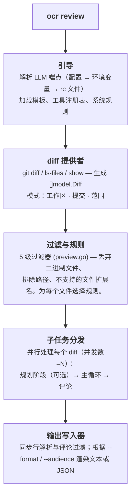
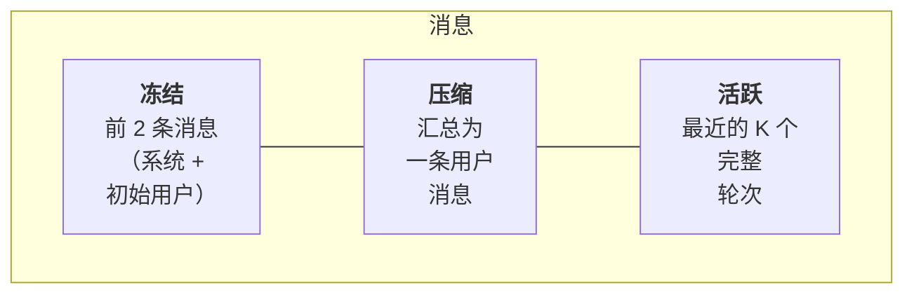

详细描述 `ocr review` 的内部工作原理：从按下回车键到 JSON 出现在终端中。本文档将帮助您理解 OCR 的架构、诊断其行为、选择合适的启动参数，并深入了解项目的实现细节。

## 高层流水线



编排逻辑在 [`internal/agent/`](https://github.com/alibaba/open-code-review/blob/main/internal/agent/) 包中实现，包含四个文件：

- `agent.go` — 主循环与任务分发；
- `compression.go` — 上下文压缩；
- `preview.go` — 文件过滤器；
- `util.go` — 辅助函数。

主要入口点：

- `Agent.Run` — 流水线起点；
- `Agent.dispatchSubtasks` — 将任务分发到各个文件。

## Diff 提供者

在 `internal/diff/git.go` 中定义了 `Provider` 结构体，其私有字段 `mode`（类型为 `Mode`，基于 `int` 的枚举）根据 CLI 参数选择三种模式之一：

| 模式 | 条件 | 结果 |
|---|---|---|
| `Workspace` | 无参数 | 已暂存、未暂存和未跟踪的更改 |
| `Commit` | `--commit <sha>` / `-c <sha>` | `<sha>` 引入的更改（通过 `git show <sha>`，等同于 diff `<sha>^..<sha>`） |
| `Range` | `--from <a> --to <b>` | `merge-base(a, b)..b` |

每个 diff 包含旧路径和新路径、旧片段和新片段、添加和删除的行数、二进制文件标志以及重命名信息。`DiffContextLines` 的值固定为 **3**，这也是 Git 的默认值。

未跟踪的文件会从磁盘读取，并视为完全新增，以便在提交前对其进行审查。

## 五级文件过滤器

加载 diff 后，每个文件都会经过 [`whyExcluded`](https://github.com/alibaba/open-code-review/blob/main/internal/agent/preview.go) 函数。该函数返回以下值之一：

```
binary          — 文件是二进制文件
user_exclude    — 与 `exclude` 列表中的模式匹配
unsupported_ext — 扩展名不在 supported_file_types.json 中
default_path    — 与内置的测试文件排除模式匹配
```

如果文件未被排除，则返回空值。

`deleted` **不会**由 `whyExcluded` 函数返回：它会在 `Preview()` 中稍后计算，当保留文件的 diff 报告 `IsDeleted` 时。

检查按以下顺序执行：

1. `binary` — 二进制文件首先被丢弃。
2. `user_exclude` — 您项目中的 `exclude` 值始终具有最高优先级。
3. `user_include` — 如果过滤器有包含模式 **并且** 文件与其中一个模式匹配，则立即保留该文件（返回空值），跳过下面的 `unsupported_ext` 和 `default_path` 检查。
4. `unsupported_ext` 根据允许的扩展名列表进行过滤。
5. `default_path` — 最后一项检查：匹配内置的**测试文件**排除模式（`**/*_test.go`、`**/*.test.{js,jsx,ts,tsx}`、`**/__tests__/**`、`**/*_test.py`、`**/*_spec.rb`、`**/*.test.ets` 等）。每个模式都以 `**/` 开头。

不相关目录（`vendor/`、`node_modules/`、`target/` 等）的剔除发生在更早的阶段，即在 diff 提供者层面。`internal/diff/git.go` 中的 `providerDirIgnoreDirs` 列表定义了这些目录，`filterDiffs` 函数会在单个文件过滤之前移除这些目录的 diff。

要查看完整的过滤结果而不消耗任何 token，请运行 `ocr review --preview`。完整算法在[审查规则](../review-rules/#how-files-are-filtered)部分有详细说明。

## 文件子任务：规划与主循环

对于每个通过过滤的文件，OCR 会启动一个子代理。每个子代理在独立的 goroutine 中运行，数量受 `--concurrency` 限制（默认 **8**），并拥有自己的 LLM 消息缓冲区。

子任务包含最多**两个阶段**：

### 阶段 1 — 规划（可选）

```go
threshold := template.PlanModeLineThreshold     // 50
changeLines := d.Insertions + d.Deletions
if changeLines < threshold { skip plan }
```

对于小型 diff，规划会增加延迟但收益甚微，因此会被静默跳过，直接进入主循环。对于较大的 diff，OCR 会使用 `PLAN_TASK` 执行**一次** LLM 调用：不传递 `Tools` 字段，因此在规划期间模型无法调用工具。只读工具子集（`code_search`、`file_read_diff`、`file_find` — 这三个工具在 `tools.json` 中 `plan_task` 标志为 `true`）会通过 `{{plan_tools}}` 占位符（由 `formatToolDefs` 函数生成）作为纯文本嵌入，以便模型了解后续可用的工具。模型返回一个检查清单，该清单成为主提示词中 `{{plan_guidance}}` 的值。

### 阶段 2 — 主循环

主循环构建 `MAIN_TASK` 提示词，并与模型进行基于工具的对话。完整工具集在规划阶段工具的基础上增加了 **`task_done`**、**`code_comment`** 和 **`file_read`**。完整列表见[工具](../tools/)部分。

```
循环至 MAX_TOOL_REQUEST_TIMES（默认 30）次：
    response = llm.complete(messages, tools)
    if response.toolCalls 为空：
        提示模型 "您未成功调用任何工具。
                  请重试，或如果已完成请使用 task_done。"
        继续
    对于每次调用：执行 → 收集结果
    如果任何调用是 task_done：跳出循环
    addNextMessage(...)              # 可能触发压缩
```

循环有五个终止条件：

1. 调用了 `task_done`。
2. 达到 `MAX_TOOL_REQUEST_TIMES` 次数上限。
3. 连续三轮未获得有效的工具结果（`maxConsecutiveEmptyRounds = 3`）。
4. 上下文被取消。
5. `addNextMessage` 返回 `false`：压缩未能将消息缓冲区降至警告阈值以下。

在所有情况下，收集到的 `code_comment` 调用都会成为审查评论。

## 上下文压缩

长时间的工具调用循环最终会填满上下文窗口。OCR 通过**三区域划分**策略来管理此问题，该策略在达到 `MAX_TOKENS = 58888` 设定的 token 预算时触发：

| 阈值 | 常量 | 操作 |
|---|---|---|
| MAX_TOKENS 的 60% | `tokenSoftThreshold` | 启动**异步**后台压缩；当前循环继续执行。 |
| MAX_TOKENS 的 80% | `tokenWarningThreshold` | 在发送下一个请求前**同步**执行压缩。 |

### 三个区域



一个“轮次”包含一条助手消息及其后的工具结果消息。`partitionMessages` 从末尾向前遍历轮次，保留尽可能多的轮次，使其适合 `(0.80 × MAX_TOKENS) - reservedTokens`。更早的内容构成**压缩区域**。

压缩区域被转换为 XML，并通过 `MEMORY_COMPRESSION_TASK` 提示词传递给模型；返回的摘要会添加到原始用户消息中，包裹在 `<previous_review_summary>` 标签内。

压缩后：`messages = frozen[2] + compressed_user_msg + active`。

```go
// compression.go
func (a *Agent) runCompression(ctx context.Context, msgs []llm.Message, filePath string) ([]llm.Message, error) {
    part := partitionMessages(msgs, a.args.Template.MaxTokens, 0)
    contextXML := buildMessageXML(msgs[part.frozenEnd:part.compressEnd])
    // … 调用 MEMORY_COMPRESSION_TASK …
    rebuilt[1] = llm.NewTextMessage(role, currentText+
        "\n\n<previous_review_summary>\n"+rawSummary+"\n</previous_review_summary>")
    for i := part.compressEnd; i < len(msgs); i++ {
        rebuilt = append(rebuilt, msgs[i])
    }
    return rebuilt, nil
}
```

### 异步与同步压缩

在异步模式下，主循环在后台压缩进行时继续执行工具调用。在下一次 token 数检查时，通过 `tryApplyPendingCompression` 函数替换准备好的摘要。如果在异步任务完成前 token 占比超过警告阈值，循环将暂停并同步运行 `runCompression`，确保下一个请求能放入上下文。

## 评论处理流水线

每次 `code_comment` 工具调用都会生成一条或多条草稿评论。这些评论通过 **CommentWorkerPool**（固定大小的 goroutine 池）处理，以避免主工具循环被后处理阻塞：

1. **行定位**（在处理程序中）— 使用滑动窗口算法将 `existing_code` 与 diff 匹配，计算精确的 `start_line` / `end_line`。如果匹配失败，两个值均设为 `0`。行范围 `0` 作为“未定位”评论的隐式标志，需要用户手动查找（不保存单独的标志；后续消费者检查 `start_line == 0`）。
2. **重新定位任务** *（可选后备方案）* — 如果在复杂的 diff 中无法定位行号，OCR 会运行 `RE_LOCATION_TASK` 提示词，要求模型重新定位代码片段。这对于被改写的 `existing_code` 行很有用。
3. **评论过滤器** — 主循环结束后（且处理程序池清空后），LLM 调用 `REVIEW_FILTER_TASK` 根据 diff 检查收集到的评论，并删除可证明不正确的评论。此阶段的错误会记录到日志并被忽略。
4. **重新定位行号** — 从 `Agent.Run` 返回后，顶层命令会对完整的评论集重新运行 `diff.ResolveLineNumbers`（参见 `cmd/opencodereview/review_cmd.go`），以处理 `existing_code` 跨多个文件或在重新定位阶段被修改的评论。
5. **生成输出** — 根据 `--format` 输出为文本或 JSON。

## Token 预算限制器

在调用 LLM 之前，OCR 会执行一次立即终止的检查：

```go
tokenLimit := MaxTokens * 4 / 5     // 80 %
if countMessagesTokens(messages) > tokenLimit {
    record warning "token_threshold_exceeded"
    return nil      // 跳过此文件
}
```

这会在发送请求前拦截巨大的 diff（如自动生成的 lock 文件、涉及数千行更改的重构）。被跳过的文件会在 stdout 中标记为非关键警告，并添加到 JSON `warnings` 数组中。

第二次检查在 `filterLargeDiffs` 中执行：如果单个 diff 超过 `MAX_TOKENS` 的 80%，它会在单个文件分发器启动前被丢弃。

## 模板与占位符

在 `internal/config/template/task_template.json` 中有**五个提示词**：

| 键 | 用途 |
|---|---|
| `PLAN_TASK` | 规划阶段 — 生成检查清单。 |
| `MAIN_TASK` | 主审查循环 — 执行 `code_comment` 调用。 |
| `MEMORY_COMPRESSION_TASK` | 生成压缩区域的摘要。 |
| `REVIEW_FILTER_TASK` | 主循环后的阶段，删除可证明不正确的评论。 |
| `RE_LOCATION_TASK` | 重新定位无法匹配 `existing_code` 的评论。 |

每个提示词都是指向模板目录中 `.md` 文件的 `{role, prompt_file}` 引用列表（例如 `{"role": "system", "prompt_file": "main_task_system.md"}`）。加载时，`resolveConversation` 将这些文件读入内存中的 `{role, content}` 消息，然后为每个文件单独替换模板占位符：

| 占位符 | 值 |
|---|---|
| `{{system_rule}}` | 从四级链中选择的规则文本。 |
| `{{change_files}}` | PR 中每个其他已更改文件的状态和路径。 |
| `{{diff}}` | 此文件的 diff（`git diff` 的原始输出）。 |
| `{{current_file_path}}` | 此文件的新路径。 |
| `{{plan_guidance}}` | 规划阶段的结果；如果跳过规划则删除。 |
| `{{plan_tools}}` | 规划阶段工具的定义，作为纯文本（由 `formatToolDefs` 函数生成），用于 `PLAN_TASK` 系统提示词。 |
| `{{requirement_background}}` | `--background` 参数的内容。 |
| `{{current_system_date_time}}` | 本地启动时间戳，格式为 `YYYY-MM-DD HH:MM`（不含秒和时区）。 |
| `{{context}}` | 仅在压缩时：转换为 XML 的消息，用于生成摘要。 |
| `{{path}}` | 文件路径，用于 `REVIEW_FILTER_TASK`。 |
| `{{comments}}` | 累积的评论（JSON），用于 `REVIEW_FILTER_TASK`。 |

占位符替换在 [`agent.go`](https://github.com/alibaba/open-code-review/blob/main/internal/agent/agent.go) 中实现。模板本身无法通过 CLI 覆盖：要修改提示词，请编辑 [`task_template.json`](https://github.com/alibaba/open-code-review/blob/main/internal/config/template/task_template.json) 并重新构建项目。`--tools` 参数覆盖的是*工具注册表*（替换 `internal/config/toolsconfig` 使用的 JSON），而非模板。参见[工具](../tools/#customizing-tools)部分。

> **占位符语法说明。** 上述所有占位符均使用双花括号 `{{…}}`，**但** `RE_LOCATION_TASK` 使用单括号 `{diff}`、`{existing_code}` 和 `{suggestion_content}` 替换值（参见 `internal/diff/relocation.go`）。

## 数据存储

每次审查都会以 JSONL 格式写入磁盘：

```
~/.opencodereview/sessions/<encoded-repo-path>/<session-id>.jsonl
```

仓库路径**不**进行 base64 编码：`encodeRepoPath` 函数（在 `internal/session/persist.go` 中）将 `/` 和 `\` 替换为 `-`，将 `:` 替换为 `_`，使路径对文件系统安全。

每一行都是一个独立事件：发送的提示词、LLM 响应、工具调用、工具结果、生成的评论等。Web 界面（`ocr viewer`）直接读取这些文件：没有数据库，只有追加式日志。界面和事件模式的描述见[查看会话](../viewer/)部分。

## 遥测

当遥测启用时，代理会在流水线层面创建三种 span：`review.run` 覆盖整个任务，`diff.parse` 覆盖 diff 加载，每个被审查的文件都会创建 `subtask.execute.<file>`。此外，在每个决策点都会创建短生命周期的 `event.<name>` span（`plan.skipped`、`token.threshold.exceeded`、`subtask.error` 等）。LLM 调用和工具调用仅记录为指标，不作为 span。提示词和响应的内容**从不**附加到遥测数据；`OCR_CONTENT_LOGGING` 标志已连接但目前不生效。完整模式见[遥测](../telemetry/)部分。

## 未自动化的部分

某些决策有意保留为手动操作：

- **端点发现没有 `fallback`。** 如果配置、环境变量和 rc 文件未提供完整的 `(URL, token, model)` 集合，OCR 将以非零代码退出，而不是尝试猜测值。
- **子代理错误被隔离，但不进行重试。** 单个文件的错误会生成警告，其余文件继续处理。重试应在外部 CI 流水线中执行，而非在代理内部。
- **文件之间没有推理。** 每个文件都在与 LLM 的独立对话中审查。文件间的问题通过 `file_read_diff` / `code_search` 工具调用解决，而非共享上下文。在这些*其他*文件中的发现也不能用作评论目标：`main_task` 提示词指示模型仅将上下文工具用于理解，并