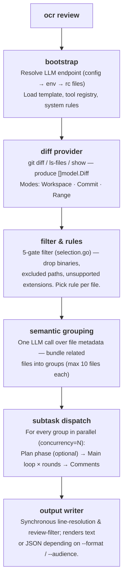
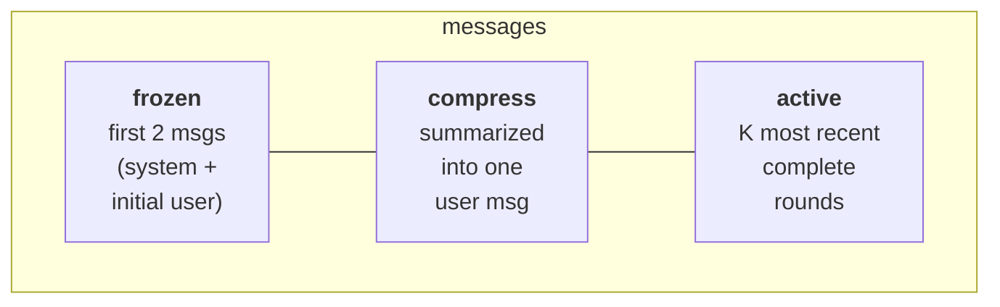

深入说明 `ocr review` 的内部工作机制：从按下 Enter 到终端出现 JSON。本文帮助你理解 OCR 的构造、诊断其行为、选择合适的启动参数，并了解项目的实现。

## 高层流水线



编排逻辑实现在
[`internal/agent/`](https://github.com/alibaba/open-code-review/tree/main/internal/agent/)
包中。主要文件：

- `agent.go` — 按组进行调度和编排；
- `grouping.go` — 文件的语义分组；
- `selection.go` — 文件过滤器；
- `preview.go` — `--preview` 报告；
- `util.go` — 辅助函数。

工具调用循环和记忆压缩位于相邻的
[`internal/llmloop/`](https://github.com/alibaba/open-code-review/tree/main/internal/llmloop/)
包中。

主要入口点：

- `Agent.Run` — 流水线起点；
- `Agent.dispatchSubtasks` — 将任务分配到文件组。

## diff 提供者

`internal/diff/git.go` 中定义了 `Provider` 结构体，其私有字段 `mode`（类型 `Mode`，基于 `int` 的枚举）选择三种模式之一，对应 CLI 参数：

| 模式 | 条件 | 结果 |
|---|---|---|
| `Workspace` | 无参数 | 已暂存、未暂存和未跟踪的变更 |
| `Commit` | `--commit <sha>` / `-c <sha>` | `<sha>` 引入的变更（通过 `git show <sha>`，等价于 diff `<sha>^..<sha>`） |
| `Range` | `--from <a> --to <b>` | `merge-base(a, b)..b` |

每个 diff 包含旧路径和新路径、旧片段和新片段、新增和删除行数、二进制文件标志以及重命名信息。`DiffContextLines` 固定为 **3**——这也是 Git 的默认值。

未跟踪文件从磁盘读取，并视为全部新增，以便在提交前进行检查。

## 五级文件过滤器

加载 diff 后，每个文件都要经过
[`whyExcluded`](https://github.com/alibaba/open-code-review/blob/main/internal/agent/selection.go)
函数。它返回以下值之一：

```
binary          — 文件是二进制文件
user_exclude    — 匹配 `exclude` 列表中的模式
unsupported_ext — 扩展名不在 supported_file_types.json 中
default_path    — 匹配内置的测试文件排除模式
```

如果文件未被排除，函数返回空值。

`deleted` 和 `too_large` **不会**由 `whyExcluded` 返回：它们由 `selectFiles` 在检查之后应用——`deleted` 在保留文件的 diff 报告 `IsDeleted` 时应用，`too_large` 在仅 diff 就超过 `max_tokens` 的 80% 时应用。

检查按以下顺序执行：

1. `binary` — 二进制文件最先被丢弃。
2. `user_exclude` — 项目的 `exclude` 值始终优先。
3. `user_include` — 如果过滤器有包含模式**且**文件匹配其中之一，则立即保留（返回空值），跳过下方的 `unsupported_ext` 和 `default_path` 检查。
4. `unsupported_ext` 按允许的扩展名列表过滤。
5. `default_path` — 最后一项检查：匹配内置的**测试文件**排除模式（`**/*_test.go`、`**/*.test.{js,jsx,ts,tsx}`、`**/__tests__/**`、`**/*_test.py`、`**/*_spec.rb`、`**/*.test.ets` 等）。每个模式都以 `**/` 开头。

无关目录（`vendor/`、`node_modules/`、`target/` 等）的剔除发生在更早的 diff 提供者层面。`internal/diff/git.go` 中的 `providerDirIgnoreDirs` 列表定义了这些目录，它们的 diff 在单文件过滤之前就被移除。Preview 将这些文件报告为 `provider_directory`；`include` 规则无法将它们恢复以进行检查。

该列表按路径前缀匹配，因此只覆盖**仓库根目录**下的目录。同名的嵌套目录会进入文件过滤器并被排除为 `default_path`：`vendor/pkg/x.go` 标记为 `provider_directory`，而 `api/vendor/pkg/x.go` 标记为 `default_path`，只有后者可以通过 `include` 规则恢复。

要查看完整的过滤结果而不消耗任何 token，请运行 `ocr review --preview`。完整算法见[审查规则](../review-rules/#how-files-are-filtered)一节。

## 文件的语义分组

过滤后，OCR 使用 `GROUPING_TASK` 任务发起一次 LLM 调用（`internal/agent/grouping.go`）。只向模型传递**文件元数据**（路径、状态、`+`/`-` 行数）——不包含 diff 内容——并要求它将语义相关的文件合并为一组，以便一起审查。同一模块或同一功能的文件、生产者—消费者关系（接口与实现）、同一资源的 i18n / 配置变体，以及同一目录下解决同一任务的文件，通常会被分到一组。

限制和回退方案：

- 每个文件恰好属于一个组；每组不超过 `maxFilesPerGroup = 10` 个文件。
- 如果组内 diff 的 token 总数超过限制，该组会被拆分为单文件组（`enforceGroupTokenBudget`）。
- 如果分组调用出错、返回空响应或只有一个文件，OCR 回退到**每个文件一组**的分发方式。

## 组的子任务：规划与主循环

对于每个文件组，OCR 启动一个子代理。每个子代理在独立的 goroutine 中运行，数量受 `--concurrency` 限制（默认 **8**），并拥有自己的 LLM 消息缓冲区。

子任务包含最多**两个阶段**：

### 阶段 1 — 规划（可选）

```go
// template.PlanRequired(fileCount, totalChanged, maxFileChanged)
PlanModeLineThreshold      = 50    // 组内单个文件的最大变更行数
PlanModeGroupLineThreshold = 100   // 多文件组的变更行总数

if maxFileChanged >= 50                      { run plan }   // 单个文件的大变更
if fileCount >= 2 && totalChanged >= 100     { run plan }   // 多个中等变更
otherwise                                    { skip plan }
```

两个阈值协同工作：`PLAN_MODE_LINE_THRESHOLD` 关注组内最大的文件，`PLAN_MODE_GROUP_LINE_THRESHOLD` 关注整个组的变更总量。第二个阈值故意设得更大，以免规划阶段无条件执行。

对于小型 diff，规划会增加延迟却没有收益，因此会被静默跳过，直接启动主循环。对于较大的 diff，OCR 使用 `PLAN_TASK` 发起**一次** LLM 调用：不传递 `Tools` 字段，因此规划期间模型无法调用工具。只读工具子集（`code_search`、`file_read`、`file_read_diff`、`file_find`——通过 `task_template.json` 中的 `PLAN_TASK.tool_references` 选择）通过 `{{plan_tools}}` 占位符以普通文本形式嵌入（由 `formatToolDefs` 函数生成），以便模型知道稍后可以使用哪些工具。模型返回一个检查清单，成为主提示中 `{{plan_guidance}}` 的值。

### 阶段 2 — 主循环（多轮）

主循环构建 `MAIN_TASK` 提示，并与模型进行工具调用对话。完整工具集在规划阶段的工具基础上增加 **`task_done`** 和 **`code_comment`**。完整列表见[工具](../tools/)一节。

整个主循环最多重复 `MAX_REVIEW_ROUNDS` 次（通过 `--effort` 设置：`low` = 1 轮，`medium` = 2 轮（默认），`high` = 3 轮）。从第二轮开始，规划结果被丢弃（以免限制发现的完整性），前几轮确认的评论作为"已发现"上下文传递，以便模型寻找**新**问题。如果某一轮没有新发现，或确认的评论数达到上限，循环提前停止。

```
loop up to MAX_TOOL_REQUEST_TIMES (default 100):
    response = llm.complete(messages, tools)
    if response.toolCalls is empty:
        nudge model with "You did not successfully call any tools.
                          Please try again or use task_done if finished."
        continue
    for each call: execute → collect result
    if any call was task_done: break
    addNextMessage(...)              # may trigger compression
```

循环有五个终止条件：

1. 调用了 `task_done`。
2. 用尽了 `MAX_TOOL_REQUEST_TIMES` 次数。
3. 连续三轮未获得有效的工具结果（`maxConsecutiveEmptyRounds = 3`）。
4. 上下文被取消。
5. `addNextMessage` 返回 `false`：压缩未能将消息缓冲区降到警告阈值以下。

在所有情况下，收集到的 `code_comment` 调用都会成为审查评论。

## 记忆压缩

长时间的工具调用循环会逐渐填满上下文窗口。OCR 通过**三区划分**策略管理，在达到 `MAX_TOKENS = 200000` 设定的 token 预算时触发。注意：`MAX_TOKENS` 只限制**提示**；模型输出上限由单独的参数 `MAX_COMPLETION_TOKENS = 16384` 设定，因此通过 `--max-tokens` 增加提示限制不会扩大输出预算。

| 阈值 | 常量 | 动作 |
|---|---|---|
| MAX_TOKENS 的 60% | `tokenSoftThreshold` | 启动**异步**后台压缩；当前循环继续执行。 |
| MAX_TOKENS 的 80% | `tokenWarningThreshold` | 在发送下一个请求前**同步**执行压缩。 |

在选择活跃轮次之前，OCR 为摘要文本预留空间：不超过配置的输出限制、上下文窗口的 20%，以及扣除固定提示和包装后的剩余量。某些提供者将推理 token 计入输出限制。如果压缩请求本身在 80% 阈值之前还有空间，OCR 可以在配置的限制内增加生成预算，要求模型将摘要文本控制在预留范围内。重建后的对话大小仍会被检查。单个对话的限制与 `--max-tokens-budget` 的总预算无关；将该预算设为零不会禁用上下文压缩。

### 三个区



"轮次"是一条助手消息及其后的工具结果消息。`partitionMessages` 从末尾遍历轮次，尽可能保留更多轮次，直到其 token 数严格小于 `(0.80 × MAX_TOKENS) - reservedTokens`。预留包括前两条消息（含之前的摘要）、新摘要文本的预留及其包装。所有更早的内容构成**压缩区**。如果压缩区为空，对话保持不变；只要原始对话低于警告阈值，后台压缩就不会将固定前缀之后的所有轮次折叠为摘要。

压缩区被转换为 XML，连同 `MEMORY_COMPRESSION_TASK` 提示一起传给模型；返回的摘要追加到原始用户消息中，位于 `<previous_review_summary>` 标签内。

压缩后：`messages = system + (original_user + summary) + active`。重建后的对话用相同的本地 token 估算进行检查，必须小于原始对话。缺少压缩模板、摘要为空或结果未减少体积时，保留原始历史不变。摘要模板不可用或重建后超出限制会导致错误，且不会删除任何原始消息。

### 异步与同步压缩

异步模式下，主循环在后台压缩进行时继续执行工具调用。在下一次 token 数检查时，已完成的摘要由 `tryApplyPendingCompression` 函数插入。如果在异步任务完成前 token 占比越过警告阈值，循环暂停并同步运行 `runCompression`。在后台快照创建后添加的消息在应用摘要时保留。如果对话仍无法严格降到本地警告阈值以下，循环以 `StopCompression` 停止，而不是静默丢弃未压缩的历史。此估算不保证与提供者上下文窗口的实际容量一致。

## 评论处理流水线

每次 `code_comment` 工具调用创建一个或多个草稿评论。它们经过 **CommentWorkerPool**（固定大小的 goroutine 池），以免主工具调用循环在后续处理上阻塞：

1. **行定位**（在处理程序中）— 通过滑动窗口算法将 `existing_code` 与 diff 匹配，计算精确的 `start_line` / `end_line`。如果匹配失败，两个值都设为 `0`。行范围 `0` 是"未定位"评论的隐式标志，用户需手动查找（不保存单独的标志；后续消费者检查 `start_line == 0`）。
2. **重新定位任务** *（可选回退）* — 如果在复杂 diff 中无法确定行，OCR 启动 `RE_LOCATION_TASK` 提示，要求模型重新绑定片段。这对于被改写的 `existing_code` 行很有用。
3. **审查过滤** — 主循环结束后（且处理程序池清空），`REVIEW_FILTER_TASK` LLM 调用根据 diff 检查收集的评论，删除可证明错误的评论。此阶段的错误记录到日志并忽略。
4. **重新定位行** — 从 `Agent.Run` 返回后，顶层命令对完整评论集重新运行 `diff.ResolveLineNumbers`（见 `cmd/opencodereview/review_cmd.go`），以处理 `existing_code` 跨多个文件或在重新定位阶段被修改的评论。
5. **生成输出** — 根据 `--format` 输出为文本或 JSON。

## token 预算限制器

在调用 LLM 之前，OCR 执行一次立即终止的检查：

```go
tokenLimit := MaxTokens * 4 / 5     // 80 %
if countMessagesTokens(messages) > tokenLimit {
    record warning "token_threshold_exceeded"
    return nil      // skip this group
}
```

它在巨大 diff（自动生成的 lock 文件、涉及数千行的重构）需要请求之前将其拦截。被跳过的组在 stdout 中标记为非致命警告，并添加到 JSON 的 `warnings` 数组。

第二项检查在 `selectFiles` 中执行：如果单个 diff 超过 `MAX_TOKENS` 的 80%，它在分组和调度之前就被丢弃，并标记为 `too_large`。第三道防线在分组内部——见上文的 `enforceGroupTokenBudget`。

## 模板与占位符

`internal/config/template/task_template.json` 中包含**六个提示**：

| 键 | 用途 |
|---|---|
| `GROUPING_TASK` | 将变更文件合并为语义相关的组。 |
| `PLAN_TASK` | 规划阶段——生成检查清单。 |
| `MAIN_TASK` | 主审查循环——执行 `code_comment` 调用。 |
| `MEMORY_COMPRESSION_TASK` | 生成压缩区的摘要。 |
| `REVIEW_FILTER_TASK` | 主循环后的阶段，删除可证明错误的评论。 |
| `RE_LOCATION_TASK` | 重新绑定无法匹配 `existing_code` 的评论。 |

每个提示是模板目录中 `.md` 文件的 `{role, prompt_file}` 引用列表（例如 `{"role": "system", "prompt_file": "main_task_system.md"}`）。加载时，`resolveConversation` 将这些文件读入内存中的 `{role, content}` 消息，然后为每个组单独替换模板占位符：

| 占位符 | 值 |
|---|---|
| `{{system_rule}}` | 从四级链中选择的规则文本。 |
| `{{change_files}}` | 其他变更文件的状态和路径，**不属于当前组**。 |
| `{{diffs}}` | 当前组所有文件的 diff：每个文件包裹在 `<file>` 元素中，整体包裹在 `<review_files>` 中。 |
| `{{file_list}}` | 仅用于 `GROUPING_TASK`：变更文件的元数据列表——路径、状态、`+`/`-` 行数。 |
| `{{plan_guidance}}` | 规划阶段的结果；如果跳过规划则移除。 |
| `{{confirmed_comments}}` | 前几轮确认的发现；第一轮为空并被移除。 |
| `