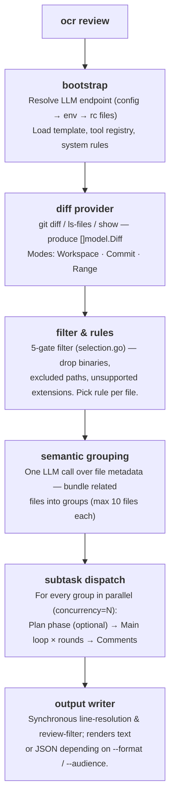
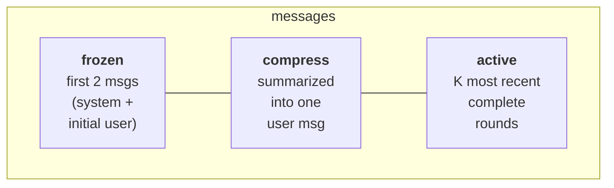

从你按下回车到 JSON 落在终端，`ocr review` 内部实际如何运作的导览。旨在帮你建立足够的心智模型，以调试行为、调优参数，并有把握地阅读源码。

## 高层流水线



编排逻辑位于
[`internal/agent/`](https://github.com/alibaba/open-code-review/tree/main/internal/agent/)
包，主要文件有：`agent.go`（分发与按组编排）、`grouping.go`（语义文件分组）、
`selection.go`（文件过滤）、`preview.go`（`--preview` 报告）和 `util.go`（辅助）；
工具调用循环与记忆压缩位于相邻的
[`internal/llmloop/`](https://github.com/alibaba/open-code-review/tree/main/internal/llmloop/)。
两个入口点值得关注：`Agent.Run`（流水线顶部）和 `Agent.dispatchSubtasks`
（per-group 扇出）。

## diff provider

`internal/diff/git.go` 定义了一个 `Provider` 结构，其未导出字段 `mode`（类型为
`Mode`，一个 `int` 枚举）选择与 CLI 参数对应的三种模式之一：

| 模式 | 触发方式 | 返回内容 |
|---|---|---|
| `Workspace` | 无参数 | staged + unstaged + untracked 变更 |
| `Commit` | `--commit <sha>` / `-c <sha>` | `<sha>` 引入的变更（经 `git show <sha>`，等价于 `<sha>^..<sha>` diff） |
| `Range` | `--from <a> --to <b>` | `merge-base(a, b)..b` |

每个 diff 携带：old/new path、old/new hunk、插入/删除计数、二进制标志、重命名
检测。`DiffContextLines` 固定为 **3**——与 Git 默认一致。

untracked 文件从磁盘读取并作为整文件新增处理，以便 commit 前评审。

## 五重门文件过滤

diff 加载后，每个文件经过
[`whyExcluded`](https://github.com/alibaba/open-code-review/blob/main/internal/agent/selection.go)。
该函数返回以下之一：

```
binary          — file is binary
user_exclude    — matched a pattern in your `exclude` list
unsupported_ext — extension is not in supported_file_types.json
default_path    — matched a built-in test-file exclude pattern
```

……或文件被保留时返回空。`deleted` 和 `too_large` **不**由 `whyExcluded` 返回；
它们由 `selectFiles` 在各门之后施加——`deleted` 用于 diff 报告 `IsDeleted` 的被保留
文件，`too_large` 用于仅 diff 本身就超过 `max_tokens` 80% 的文件。各门按以下顺序执行：

1. `binary`——二进制文件先被丢弃。
2. `user_exclude`——你项目的 `exclude` 总是优先。
3. `user_include`——若配置了 include 模式**且**文件匹配其一，立即保留
   （返回空），绕过下面的 `unsupported_ext` 和 `default_path` 门。
4. `unsupported_ext` 按扩展名白名单过滤。
5. `default_path` 是最后一道门：匹配内置**测试文件**排除模式
   （`**/*_test.go`、`**/*.test.{js,jsx,ts,tsx}`、`**/__tests__/**`、
   `**/*_test.py`、`**/*_spec.rb`、`**/*.test.ets`……）。每个模式都以
   `**/` 作为根前缀。

噪声目录过滤（`vendor/`、`node_modules/`、`target/`……）发生在更早的阶段，
位于 diff-provider 层，通过 `internal/diff/git.go` 中的 `providerDirIgnoreDirs`
列表——这些目录的 diff 被解析后即被剔除，永远不会到达 per-file 过滤器。
Preview 将这些文件报告为 `provider_directory`；`include` 规则无法让它们变为可评审。

该列表按路径前缀匹配，因此只覆盖**仓库根目录**下的目录。嵌套的同名目录会进入
per-file 过滤，并由 `default_path` 排除：`vendor/pkg/x.go` 报告为
`provider_directory`，而 `api/vendor/pkg/x.go` 报告为 `default_path`，只有后者能被
`include` 规则重新纳入。

运行 `ocr review --preview` 可不花 token 查看完整过滤结果。完整算法见
[评审规则](../review-rules/#how-files-are-filtered)。

## 语义文件分组

过滤之后，OCR 先做一次 `GROUPING_TASK` LLM 调用（`internal/agent/grouping.go`），
只把**文件元数据**（路径、状态、`+`/`-` 行数）发给模型——不含 diff 内容——请它
把语义相关的文件聚成一组，一起评审。通常会归为一组的文件包括：同一模块 / 特性、
存在生产者/消费者关系（接口与实现）、同一资源的 i18n / 配置变体、以及同目录下
协作完成同一件事的文件。

约束与兜底：

- 每个文件恰好属于一个组；单个组最多 `maxFilesPerGroup = 10` 个文件。
- 一组 diff 的合计 token 超过限制时，该组被拆成单文件组
  （`enforceGroupTokenBudget`）。
- 分组调用失败、返回空或只有 1 个文件时，退化为**每文件一组**的分发方式。

## 每组子任务：plan + main

对每个文件组，OCR 启动一个子 agent。每个子 agent 在自己的 goroutine
中运行，受 `--concurrency`（默认 **8**）约束，并有独立的 LLM 消息缓冲区。

一个子任务最多有**两个阶段**：

### 阶段 1——Plan（可选）

```go
// template.PlanRequired(fileCount, totalChanged, maxFileChanged)
PlanModeLineThreshold      = 50    // 组内单文件最大变更行数
PlanModeGroupLineThreshold = 100   // 多文件组的合计变更行数

if maxFileChanged >= 50                      { run plan }   // 单文件大改
if fileCount >= 2 && totalChanged >= 100     { run plan }   // 多个中等改动
otherwise                                    { skip plan }
```

两个阈值协同工作：`PLAN_MODE_LINE_THRESHOLD` 看组内最大的那个文件，
`PLAN_MODE_GROUP_LINE_THRESHOLD` 看整组的合计变更量；后者故意取更大的值，
以免 plan 阶段变成无条件执行。

对小 diff，plan 只会增加延迟、没有价值，因此被静默跳过，main 循环直接运行。对较大
diff，OCR 做一次**单次** `PLAN_TASK` LLM 调用——不发送 `Tools` 字段，因此模型
在 plan 期间不能调用工具。只读工具子集（`code_search`、`file_read`、`file_read_diff`、
`file_find`——由 `task_template.json` 中的 `PLAN_TASK.tool_references` 选择）作为纯文本
通过 `{{plan_tools}}` 占位符（由 `formatToolDefs` 渲染）嵌入，
让模型知道后续可用什么。模型返回一份清单，作为 main prompt 中的
`{{plan_guidance}}`。

### 阶段 2——main 循环（多轮）

main 循环组装 `MAIN_TASK` prompt，与模型展开工具调用对话。完整工具集在
plan 阶段工具引用基础上加 **`task_done`** 和 **`code_comment`**——
完整清单见[工具](../tools/)。

整个 main 循环最多重复 `MAX_REVIEW_ROUNDS` 次（由 `--effort` 控制：
`low` = 1 轮，`medium` = 2 轮（默认），`high` = 3 轮）。第 2 轮起会剥离
plan 结果（避免它成为召回上限），并把上一轮已确认的评论作为「已发现」上下文
回传，让模型去找**新**问题。某一轮没有新增发现，或已确认评论数达到上限时，
提前停止。

```
loop up to MAX_TOOL_REQUEST_TIMES (default 100):
    response = llm.complete(messages, tools)
    if response.toolCalls is empty:
        nudge model with "You did not successfully call any tools.
                          Please try again or use task_done if finished."
        continue
    for each call: execute → collect result
    if any call was task_done: break
    addNextMessage(...)              # may trigger compression
```

循环有五个退出条件：

1. 调用了 `task_done`。
2. `MAX_TOOL_REQUEST_TIMES` 耗尽。
3. 连续 3 轮未产生有效工具结果（`maxConsecutiveEmptyRounds = 3`）。
4. context 被取消。
5. `addNextMessage` 返回 false——压缩无法把消息缓冲区压回警告阈值以下。

无论哪种情况，已收集的 `code_comment` 调用都成为评审评论。

## 记忆压缩

长的工具调用循环最终会溢出上下文窗口。OCR 用**三分区**策略管理，触发于
`MAX_TOKENS = 200000` 定义的 token 预算。注意 `MAX_TOKENS` 只是**提示词**上限；
模型的输出上限由单独的 `MAX_COMPLETION_TOKENS = 16384` 控制，因此用
`--max-tokens` 抬高提示词上限不会连带放大输出预算。

| 阈值 | 常量 | 动作 |
|---|---|---|
| MAX_TOKENS 的 60 % | `tokenSoftThreshold` | 启动**异步**后台压缩；当前循环不中断继续。 |
| MAX_TOKENS 的 80 % | `tokenWarningThreshold` | 在发送下一个请求前**同步**运行压缩。 |

选择 active 区轮次前，OCR 先为**可见摘要**预留空间，不超过配置的输出上限、上下文窗口的
20% 余量和扣除固定提示词及摘要包装后的剩余空间。部分提供方也把推理 token 计入输出。
如果压缩请求自身距离 80% 警告阈值还有余量，OCR 可以在配置的输出上限内增加生成预算，
同时要求模型将摘要正文控制在预留空间内。重建后的会话仍须通过大小检查。
这些限制独立于累计预算 `--max-tokens-budget`；将累计预算设为零
并不会禁用上下文压缩。

### 三个区



一“轮”是一条 assistant 消息加上其后跟随的工具结果消息。`partitionMessages`
从末尾向前遍历轮次，在 token 数严格小于 `(0.80 × MAX_TOKENS) - reservedTokens`
的前提下保留尽可能多的轮。预留预算包括前两条消息（含已有摘要）、新摘要正文的
预留空间及其包装开销。更早的内容成为 **compress 区**。compress 区为空时，会话保持
不变；原会话仍低于警告阈值时，后台压缩不会把固定前缀之后的全部轮次都变成摘要。

compress 区被渲染为 XML，用 `MEMORY_COMPRESSION_TASK` prompt 交给模型；返回的
摘要被追加到原始 user 消息内，包在 `<previous_review_summary>` 标签里。

压缩后：`messages = system + (original_user + summary) + active`。
重建的会话会使用同一套本地 token 估算进行检查，并且必须比原会话更小。缺少压缩
模板、摘要为空或压缩后没有变小时，均保留原始历史。摘要模板不可用或重建结果
超限时会返回错误，不会丢弃任何原始消息。

### 异步 vs 同步

异步路径让 main 循环在后台压缩运行时继续产出工具调用；当下一次 token 检查发生
时，已就绪的摘要会通过 `tryApplyPendingCompression` 应用。若比例在异步任务完成前越过
警告阈值，循环会停顿并同步运行 `runCompression`。应用后台摘要时，会保留创建
快照之后追加的消息。如果会话仍无法严格低于本地警告阈值，循环会以
`StopCompression` 停止，而不是静默丢弃未压缩的历史。本地估算并不保证请求符合
提供方实际的上下文窗口容量。

## 评论处理流水线

每个 `code_comment` 工具调用产出一条或多条原始评论。它们经过一个
**CommentWorkerPool**（固定大小 goroutine 池），使主工具调用循环永不阻塞在
后处理上：

1. **行解析**（worker 内）——`existing_code` 用滑动窗口算法与 diff 匹配以计算
   精确的 `start_line` / `end_line`。匹配失败则两者默认为 `0`——`0` 行范围是
   “未锚定”评论的隐式信号，用户需手动定位（没有存储标志；下游消费者检查
   `start_line == 0`）。
2. **重新定位任务** *（可选回退）*——当行解析在较复杂的 diff 上失败时，OCR 运行
   `RE_LOCATION_TASK` prompt，请模型重新锚定片段。对改写过的 `existing_code`
   字符串有用。
3. **评审过滤**——main 循环结束后（worker 池排空），`REVIEW_FILTER_TASK` LLM
   调用对照 diff 检查收集到的评论，移除可证明为错的评论。此处错误被记录并忽略。
4. **第二轮行解析**——`Agent.Run` 返回后，顶层命令对完整评论集重跑
   `diff.ResolveLineNumbers`（见 `cmd/opencodereview/review_cmd.go`），以捕获
   `existing_code` 跨多文件或被重新定位步骤更新的评论。
5. **渲染**——按 `--format` 渲染为 text 或 JSON。

## token 预算守卫

在调用 LLM 之前，OCR 先做一个 fail-fast 检查：

```go
tokenLimit := MaxTokens * 4 / 5     // 80 %
if countMessagesTokens(messages) > tokenLimit {
    record warning "token_threshold_exceeded"
    return nil      // skip this group
}
```

这会在巨大 diff（自动生成的 lock 文件、触及数千行的重构）耗费请求之前把它们拦截下来。
被跳过的那一组作为非致命警告在 stdout 报告，并加入 JSON `warnings` 数组。

第二个检查在 `selectFiles` 中运行：若 diff 单独超过 `MAX_TOKENS` 的 80 %，
它在分组与分发发生之前就被过滤掉，并报告为 `too_large`。第三道守卫在分组内部
运行——见上文的 `enforceGroupTokenBudget`。

## 模板与占位符

`internal/config/template/task_template.json` 含**六个 prompt**：

| Key | 用途 |
|---|---|
| `GROUPING_TASK` | 把变更文件聚成语义相关的组。 |
| `PLAN_TASK` | plan 阶段——产出清单。 |
| `MAIN_TASK` | main 评审循环——发出 `code_comment` 调用。 |
| `MEMORY_COMPRESSION_TASK` | 摘要 compress 区。 |
| `REVIEW_FILTER_TASK` | 循环后移除可证明为错评论的流程。 |
| `RE_LOCATION_TASK` | 为 `existing_code` 无法匹配的评论重新锚定。 |

每个 prompt 是一个 `{role, prompt_file}` 引用列表，指向模板目录中的 `.md` 文件
（如 `{"role": "system", "prompt_file": "main_task_system.md"}`）。加载时
`resolveConversation` 把这些文件读入内存中的 `{role, content}` 消息，随后模板
占位符按组解析：

| 占位符 | 替换为 |
|---|---|
| `{{system_rule}}` | 从四层链解析出的规则正文。 |
| `{{change_files}}` | 本次变更中**不属于当前组**的其他文件的状态 + 路径。 |
| `{{diffs}}` | 当前组内所有文件的 diff，逐个包在 `<file>` 元素中，整体放在 `<review_files>` 里。 |
| `{{file_list}}` | （仅 `GROUPING_TASK`）